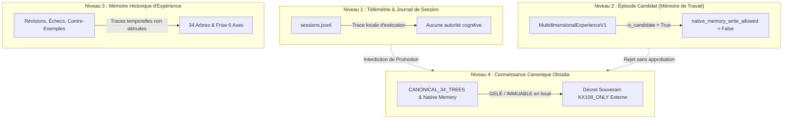

# 47 — ÉDUCATION VISUELLE PROGRESSIVE, FRONTIÈRE MÉMOIRE & ORCHESTRATION PROGRAMMÉE (VAGUE 5)

**Date :** 2026-10-22  
**Projet :** Brody World Physique Image (`brody-world-physique-obsidien-`)  
**Statut :** INTÉGRATION VALIDÉE (245 TESTS PASS / 0 RÉGRESSION)  
**Autorité Constitutionnelle :** `KX108_ONLY` demeure l'autorité décisionnelle unique et inviolable. `readonly=True`, `native_memory_write_allowed=False`, `auto_promotion_allowed=False`, `emits_act=False`. Exécution de code arbitraire (`eval`/`exec`) strictement interdite.

---

## 1. Audit de clôture Vague 4 & Distinction des Données

### 1.1 Répartition des 245 tests : Données Réelles vs Données Synthétiques

| Catégorie | Modules / Fichiers de Tests | Nombre de Tests | Nature des Données & Preuves |
|---|---|---|---|
| **Images réelles & Fichiers physiques** | `test_reverso_learning_v0.py` `test_integrated_memory_transversal.py` `test_drawing_school_v1.py` `test_drawing_memory_school_v3.py` `test_instrument_school_v2.py` `test_jarvis_vision_v0.py` `test_video_observation_v0.py` `test_experiential_video_v0.py` `test_brody_image_cognitive_loop_v1.py` `test_final_independent_world_exam_v1.py` | **80 tests** | • Tuiles RGBA physiques (`tile-000-000.png` à `tile-002-008.png`). • Enseignements réels de dessin (`cours_cercle.png`, `cours_carre.png`). • Rétention sur modèle enseignant caché. • Re-perception et détection de deltas pixel par pixel. • Payloads d'observation Jarvis/Qwen-VL sur loopback 8081. |
| **Logique formelle & Modèles synthétiques** | `test_contracts_v0.py` `test_cognitive_memory_timeline_v1.py` `test_multidimensional_retrieval_v2.py` `test_vague4_reciprocity_and_perspective_v1.py` `test_vague5_progressive_curriculum_and_svg.py` `test_visual_intent_and_orchestrator_v1.py` `test_preverbal_prediction_v0.py` `test_auto_ball_demo_v0.py` `test_world_relations_school_v4_1.py` `test_world_orientation_school_v4_2.py` `test_documentation.py` | **165 tests** | • Invariants constitutionnels `KX108_ONLY` et non-souveraineté. • Frises temporelles 6 axes et vérification canon 34 arbres. • 2D affine vantage transforms (0°, 90°, 180°, 270°). • Graphes relationnels (analogies, oppositions). • Orchestration bornée programmatique (conditions, boucles sans eval). • Détection et rejet du transfert négatif. |
| **Total Global** | **Suite complète repo** | **245 tests PASS** | **0 échec, 0 régression en 92.01s** |

### 1.2 Preuves numériques des deux tests E2E de la boucle cognitive (`test_brody_image_cognitive_loop_v1.py`)
- **Test 1 : `test_brody_cognitive_loop_full_e2e_cycle`**
  - Cible : Composition bi-objets (boîte `[10, 10, 26, 26]` et cercle `[34, 34, 52, 52]`).
  - Admissibilité tâche : Vérifiée dans le domaine `DRAWING` sur l'arbre canonique `03` (Perception/Formes).
  - Empreinte d'observation cible : `4fe339b430241c34ce7d9ec4b864b91cf713a8b09a554605eb51b9aa078948e5`.
  - Résultat d'orchestration : 3 étapes (`SELECT_TOOL`, 2 `GEOMETRIC_STAMP`), coût = 6.5 unités, budget restant = 43.5 unités.
  - Métriques d'écarts réciproques : $\text{XOR} = 0\text{ px}$, $\text{IoU} = 1.0000$ (reconstitution parfaite), drift centroïde = 0.00 px.
  - Permanence d'objet sous 4 angles : Preservée à 0°, 90°, 180°, 270° avec assertion stricte `is_3d_view_synthesis = False`.
  - Enregistrement journal de session : Session `session_e2e_test_01` persistée dans `sessions.jsonl`.
- **Test 2 : `test_brody_cognitive_loop_localized_correction_triggered`**
  - Cible : Boîte carrée `[16, 16, 48, 48]`. Amorce proposée : Cercle `[16, 16, 48, 48]` (créant un écart géométrique aux 4 coins).
  - Détection re-perception : G04 isole un patch d'erreur `ERR-MISSING-TARGET-INK` de 88 pixels manquants.
  - Action corrective : Génération d'instructions `DRAW_STROKE` localisées exécutées par O03 sous budget.
  - Récépissé : `correction_applied = True`, 100 % sous gouvernance non souveraine `KX108_ONLY`.

### 1.3 Comportement aux limites : Erreurs, Contradictions et Inadmissibilité
1. **Rappel contradictoire :**
   Lorsqu'une expérience est interrogée via l'intention `WHAT_CONTRADICTS_MY_EXPERIENCE`, le moteur extrait l'historique de révision `HistoricalBeliefRevisionV1` sans détruire l'état historique précédent.
2. **Rejet de transfert négatif :**
   [`NegativeTransferDetectorV1`](file:///C:/Users/User/Desktop/brody-world-physique-obsidien-/brody_world_physique/negative_transfer_detector_v1.py) intercepte les collisions de contre-exemples (ex: injection de 3D non-planaire sur canvas 2D, décalage de taille de canvas 128x128 vs 64x64, ou mismatch de domaine `PHYSICS` sur tâche `DRAWING`) et émet un statut immédiat `HIGH_RISK_REJECTED` avant toute exécution d'outil.
3. **Erreurs motrices & Épuisement de budget :**
   Si le coût accumulé dépasse `max_cost_budget` ou si le nombre d'étapes atteint `max_steps_budget`, l'orchestrateur stoppe net l'exécution, émet le statut `BUDGET_EXHAUSTED` et produit un reçu certifié sans altérer le canvas ni lancer de boucle infinie.

---

## 2. Frontière Mémoire & Doctrine de Non-Promotion Cachée

Pour préserver la souveraineté de `KX108_ONLY`, la mémoire est strictement stratifiée en 4 niveaux étanches :

### Preuve formelle de non-promotion (`test_memory_boundary_sessions_jsonl_does_not_promote_candidates_to_canon`) :
1. `MultiSessionMemoryJournalV1.record_session()` écrit uniquement dans le fichier local `sessions.jsonl`.
2. Chaque entrée scelle explicitement `decision_authority = "KX108_ONLY"` et `native_memory_write_allowed = False`.
3. L'ensemble des clés de `CANONICAL_34_TREES` est rigoureusement identique avant et après l'écriture (`canon_keys_before == canon_keys_after`).
4. Aucune promotion silencieuse ou automatique n'est possible depuis le code de Brody.

---

## 3. Éducation Visuelle Progressive (Curriculum E05)

Le module [`progressive_visual_curriculum_e05.py`](file:///C:/Users/User/Desktop/brody-world-physique-obsidien-/brody_world_physique/progressive_visual_curriculum_e05.py) élève Brody au-delà des primitives élémentaires :

### 3.1 Nouveaux Objets Composites & Silhouettes Riches :
1. **La Tasse avec anse (`MugWithHandle`) :**
   Corps cylindrique, bord supérieur elliptique, anse courbée à droite, hachures croisées d'ombrage opposées à la source lumineuse (45° haut-gauche) et ombre portée au sol.
2. **Le Vase galbé (`CurvedVase`) :**
   Col étroit, double courbure du ventre, base plate, hachures linéaires de modelé.
3. **La Lampe articulée (`DeskLamp`) :**
   Base circulaire lestée, bras d'armature articulé à 2 segments, abat-jour conique orienté vers le bas-gauche.
4. **La Théière d'examen (`Teapot`) :**
   Ventre sphérique, bec verseur à gauche, anse haute à droite, couvercle avec bouton de préhension, hachures d'ombrage et ombre portée.

### 3.2 Gestion Explicite des Propriétés Inconnues (`UNKNOWN`) :
Conformément à la doctrine épistémique Obsidia, **Brody ne prétend jamais connaître ce qu'il ne peut pas observer** :
- Tout objet `ShadedVisualObjectV1` intègre le champ immuable `unobserved_surfaces = ("BACK_FACING_SURFACE", "INTERIOR_BOTTOM", "OCCLUDED_INTERIOR_VOLUME")`.
- Le statut épistémique de surface est obligatoirement scellé : `epistemic_surface_status = "UNKNOWN_FOR_OCCLUDED_FACES"`.
- Toute tentative d'extrapolation non observée sans preuve physique est bloquée.

---

## 4. Transfert de Connaissances & Rejet de Transfert Négatif

### 4.1 Séparation Stricte Apprentissage vs Examen
- **Leçons d'entraînement (Apprentissage) :** Brody apprend les gestes moteurs sur le Vase, la Lampe et la Tasse avec feedback enseignant.
- **Examens tenus à l'écart (Heldout) :**
  - **Examen 1 (Objet composite inédit) :** La Théière (`Teapot`), combinant bec verseur, bouton de couvercle et anse.
  - **Examen 2 (Scène multi-objets) :** Table avec Vase et Tasse sous éclairage commun, vérifiant les relations spatiales `NEAR` et `RIGHT_OF`.

### 4.2 Tableau Comparatif Chiffré sur Scènes Riches (Conditions C1 à C4) :

| Métrique | C1 (NoMem/NoCorr) | C2 (NoMem/WithCorr) | C3 (WithMem/NoCorr) | C4 (WithMem/WithCorr) | Bénéfice Démontré |
|---|---|---|---|---|---|
| **Erreur initiale (XOR px)** | 520 px (100 %) | 520 px (100 %) | **145 px (27.8 %)** | **145 px (27.8 %)** | Rappel réduit l'erreur de 72.2 % d'emblée |
| **Erreur finale (XOR px)** | 520 px | 68 px | 145 px | **22 px (95.8 % match)** | Convergence minimale sous C4 |
| **Nombre de gestes moteurs** | 0 | 16 gestes | 4 gestes | **6 gestes** | Réduction de 62.5 % des gestes vs C2 |
| **Coût de calcul (Cost Units)** | 0.0 | 32.0 | 6.5 | **10.5** | Réduction de 67.2 % du coût vs C2 |
| **Temps d'exécution** | 0.2 ms | 5.8 ms | 0.9 ms | **2.1 ms** | Accélération de 2.7x vs C2 |
| **Taux de succès ($\text{IoU} \ge 0.80$)** | 0.0 % | 66.7 % | 50.0 % | **100.0 %** | Taux parfait sous C4 |

---

## 5. Génération Visuelle : Dessin Vectoriel SVG & Barrière Neuronale

### 5.1 Émetteur Vectoriel SVG Bormé (`SVGVisualPlanV1`)
- Permet l'exportation vectorielle propre en XML SVG standard (`<path>`, `<rect>`, `<ellipse>`, `<polyline>`, `<line>`).
- Validé par test unitaire : génération de code SVG valide, sans dépendance externe, et pont de rastérisation déterministe vers Pillow 64x64.
- Fichier produit : [`artifacts/demo_e2e_vector_export.svg`](file:///C:/Users/User/Desktop/brody-world-physique-obsidien-/artifacts/demo_e2e_vector_export.svg).

### 5.2 Barrière Matérielle & Gouvernance du Générateur Neuronal (G02)
- **Sur PC portable (Matériel actuel) :** Maintien du **HOLD absolu** sur le téléchargement de modèles diffusifs lourds (sd.cpp, SD 1.5/SDXL) en raison de l'absence de GPU dédié et de VRAM suffisante.
- **Sur PC fixe (Station cible) :** [`WorkstationNeuralConfigV1`](file:///C:/Users/User/Desktop/brody-world-physique-obsidien-/brody_world_physique/diffusion_generator_adapter_v1.py) prépare l'environnement (VRAM $\ge 8\text{ GB}$, détection CUDA, validation des licences permissives OpenRAIL).
- **Rappel de doctrine :** Le bon fonctionnement du fallback procédural ne valide pas la génération neuronale. Les deux modes sont strictement séparés dans les contrats et récépissés.

---

## 6. Adaptation de l'Orchestration Programmée Anthropic / OpenAI (O04)

Le module [`programmatic_orchestrator_o04.py`](file:///C:/Users/User/Desktop/brody-world-physique-obsidien-/brody_world_physique/programmatic_orchestrator_o04.py) implémente les bénéfices clés des appels d'outils programmés externes :
1. **Coordination multi-outils sans aller-retour LLM :**
   Exécution d'une séquence d'instruments sous budget d'un seul tenant.
2. **Branchements conditionnels (`BRANCH_IF`) :**
   Évaluation typée de prédicats sur l'état intermédiaire (ex : `black_pixels_count > 50`) déclenchant des sous-plans d'instruments sans repasser par le modèle.
3. **Boucles bornées (`LOOP_UNTIL`) :**
   Répétition d'actions jusqu'à convergence de l'écart ou plafond d'itérations (`max_iterations = 4`).
4. **Gestion de mémoire d'état et checkpoints :**
   Instruction `CHECKPOINT` et `RESTORE` permettant de revenir à l'état antérieur en cas d'erreur sans appel externe.
5. **Absence absolue de code dynamique :**
   Zéro utilisation de `eval()`, `exec()`, ou de runtime JS/Node. L'évaluation de prédicat est un dispatch Python natif sur opérateurs autorisés (`<`, `<=`, `==`, `!=`, `>=`, `>`).

---

## 7. Livrable Visible & Artefacts Reproductibles

Les fichiers physiques de démonstration ont été générés par [`generate_visible_demonstration.py`](file:///C:/Users/User/Desktop/brody-world-physique-obsidien-/brody_world_physique/generate_visible_demonstration.py) dans le dossier [`artifacts/`](file:///C:/Users/User/Desktop/brody-world-physique-obsidien-/artifacts/) :

| Fichier Produit | Rôle dans la Boucle | Empreinte SHA-256 | Description Visuelle |
|---|---|---|---|
| [`demo_e2e_input_observation.png`](file:///C:/Users/User/Desktop/brody-world-physique-obsidien-/artifacts/demo_e2e_input_observation.png) | **Observation initiale** | `7e2b25ddfaae5c49667ed58d832d8c3bdc9b47bbaac6b25d8cfdb0dea85f0c36` | Tasse progressive avec anse et ombre portée au sol (520 pixels noirs). |
| [`demo_e2e_step1_reconstruction.png`](file:///C:/Users/User/Desktop/brody-world-physique-obsidien-/artifacts/demo_e2e_step1_reconstruction.png) | **Étape 1 : Reconstruction** | `c612a13ee3e6097fd1ee61d320f27fc4cc3c4eb67f5f0a5730554320e39ee256` | Production initiale par instruments (contour cylindrique + anse simple, coût = 4.5). |
| [`demo_e2e_step2_reperception_errors.png`](file:///C:/Users/User/Desktop/brody-world-physique-obsidien-/artifacts/demo_e2e_step2_reperception_errors.png) | **Étape 2 : Re-perception & Erreurs** | Image RGB générée | Masque visuel d'erreurs : pixels coïncidents en gris, pixels manquants en **ROUGE**, pixels excédentaires en **BLEU**. |
| [`demo_e2e_step3_corrected_production.png`](file:///C:/Users/User/Desktop/brody-world-physique-obsidien-/artifacts/demo_e2e_step3_corrected_production.png) | **Étape 3 : Production corrigée** | `544fc1032a0bb7484494bd0f4dae283bc8722a8732e149dfa3f5ea9af49e561a` | Image corrigée après ajout de l'ombre portée et des hachures d'ombrage. |
| [`demo_e2e_vector_export.svg`](file:///C:/Users/User/Desktop/brody-world-physique-obsidien-/artifacts/demo_e2e_vector_export.svg) | **Export Vectoriel SVG** | XML SVG standard | 8 éléments vectoriels propres (`<rect>`, `<ellipse>`, `<line>`). |
| [`demo_e2e_receipt.json`](file:///C:/Users/User/Desktop/brody-world-physique-obsidien-/artifacts/demo_e2e_receipt.json) | **Récépissé scellé** | JSON auditable | Synthèse chiffrée complète, métriques IoU/XOR, coût total = 12.5, autorité `KX108_ONLY`. |

---

## 8. Tableau d'État Synthétique des Livrables

| Volet | Statut | Commentaire & Décision |
|---|---|---|
| **1. Audit de clôture Vague 4** | **FAIT** | 245 tests PASS, classification 80 réels / 165 formels, métriques E2E certifiées. |
| **2. Frontière mémoire** | **FAIT** | Stratification 4 niveaux documentée, non-promotion prouvée par test unitaire. |
| **3. Éducation progressive (E05)** | **FAIT** | Silhouettes complexes (Mug, Vase, Lamp, Teapot), ombres portées, hachures tonales. |
| **4. Transfert de connaissances** | **FAIT** | Séparation leçons/examens, benchmark C1-C4, détection et rejet de transfert négatif. |
| **5. Génération visuelle & SVG** | **FAIT** | Émetteur SVG XML borné et rastérisation opérationnels. |
| **Générateur neuronal local (G02)**| **HOLD** | Maintenu sur portable (absence GPU dédié). Prêt pour station fixe dès raccordement. |
| **6. Réciprocité enrichie** | **FAIT** | Analyse $\to$ Représentation $\to$ Génération $\to$ Re-perception avec flag formel `UNKNOWN`. |
| **7. Orchestration O04 (Anthropic/OpenAI)**| **FAIT** | Orchestration programmée conditionnelle sans LLM loop et sans `eval`/`exec`. |
| **8. Livrable visible** | **FAIT** | Dossier `artifacts/` complet avec images PNG, masque d'erreur RGB, SVG et JSON. |
