# 48 — AUDIT DE L'APPRENTISSAGE RÉEL & COMPÉTENCES VISUELLES TRANSFÉRABLES (ÉDITION CORRECTIVE V2)

**Date :** 2026-10-22  
**Projet :** Brody World Physique Image (`brody-world-physique-obsidien-`)  
**Statut :** AUDIT CORRECTIF VALIDÉ (251 TESTS PASS / 0 RÉGRESSION)  
**Autorité Constitutionnelle :** `KX108_ONLY` demeure l'autorité décisionnelle souveraine unique. `readonly=True`, `native_memory_write_allowed=False`, `auto_promotion_allowed=False`, `emits_act=False`.

---

## 1. Corrections Majeures Apportées dans cette Passe

Cet audit correctif répond point par point aux quatre exigences de validation transversale :

1. **Égalité stricte des budgets et instruments :**
   - Toutes les conditions (Mémoire multidimensionnelle M01–M09, Mémoire procédurale plate, Mémoire désactivée) opèrent sous le **même plafond de 8 étapes** et le **même plafond de coût de 25.0 unités**.
   - Accès aux **mêmes instruments génériques** (`SELECT_TOOL`, `GEOMETRIC_STAMP`, `DRAW_STROKE`, `ERASE_REGION`, `INSPECT_PIXELS`).
   - Mêmes opportunités de ré-observation et correction itérative pour toutes les conditions dans l'examen de reproduction visible.
2. **Tracé précis des courbes étape par étape (Isolation Rappel Initial vs Calcul Supplémentaire) :**
   - Mesure de $\text{IoU}(s)$, $\text{Erreur XOR}(s)$, et $\text{IoU}(\text{coût})$ à chaque étape.
   - Démonstration chiffrée que le rappel initial confère un biais inductif structurel immédiat ($\text{IoU} = 0.5282$ dès l'étape 4 pour la mémoire complète, contre $0.2195$ pour la condition sans mémoire), qu'aucun calcul incrémental glouton ne peut rattraper dans le budget alloué.
3. **Alignement strict avec le registre canonique des 34 arbres :**
   - L'arbre 12 est canoniquement **« Arbre de la Technique »** (Famille III_CONNAISSANCE) : instruments, montants, règles opératoires.
   - L'arbre 13 est canoniquement **« Arbre de l’Art »** (Famille III_CONNAISSANCE) : modelé pictural, hachures tonales.
   - L'arbre 03 est **« Arbre de la Perception »** (Famille I_FONDAMENTAUX) : segmentation, contrastes, extraction de contours.
   - L'arbre 20 est **« Arbre de l’Action »** (Famille V_ACTION_TRANSFORMATION) : gestes moteurs.
   - L'arbre 21 est **« Arbre de la Création »** (Famille V_ACTION_TRANSFORMATION) : composition originale sans cible.
   - L'arbre 24 est **« Arbre de la Mémoire »** (Famille VI_TEMPORELS_MEMORIELS) : rétention d'expériences historiques.
   - L'arbre 26 est **« Arbre de la Cohérence »** (Famille VII_META_STRUCTURELS) : invariants de proportions et d'alignement.
   - **Aucune altération du canon Obsidia** : le code s'adapte au registre souverain sans muter les définitions.
4. **Trois Évaluations Éducatives Distinctes :**
   - **Examen 1 : Reproduction d'une image inconnue visible** (`EXAM_ARCHED_BRIDGE`) avec cible visible en continu et boucle de correction.
   - **Examen 2 : Reconstruction après occultation** (`EXAM_CHALICE`) : cible observée brièvement, encodée en mémoire de travail, puis entièrement occultée pendant toute la phase de dessin moteur.
   - **Examen 3 : Création d'une composition inédite à partir d'une intention** (`EXAM_MONUMENTAL_PORTAL`) : aucune image cible n'est fournie ; composition architecturale synthétisée à partir d'une intention déclarative et de la mémoire générative.

---

## 2. Courbes Comparatives à Budget Identique (Examen 1 : Pont Voûté)

Toutes les conditions disposent d'un plafond de 8 étapes et d'un coût maximal de 25.0 unités.

### 2.1. Tableau Synthétique Comparatif

| Condition Évaluée | Opérations | Coût Total | IoU Finale | Erreur XOR Finale | Déviation Proportions | Expériences Retrouvées | Arbres Canoniques Interrogés |
|---|---|---|---|---|---|---|---|
| **Mémoire Multidimensionnelle (M01–M09)** | **8** | **15.5 u** | **`0.7085`** | **`413 px`** | **`0.0398`** | `ARCH-STRUCTURAL`<br>`BOWL-CURVILINEAR` | 03, 12, 13, 21, 24, 26 |
| **Mémoire Procédurale Plate (Syntaxique)** | 8 | 15.5 u | `0.2933` | `1296 px` | `0.0000` | `ARCH-STRUCTURAL` (rigide) | *Aucun (requête plate)* |
| **Mémoire Désactivée (Memory OFF)** | 8 | 12.5 u | `0.3110` | `1205 px` | `0.1335` | *Aucune (0)* | *Aucun (aveugle)* |

### 2.2. Trajectoire Étape par Étape : Isolation Rappel Initial vs Calcul

```text
Étape 1 [Coût  0.5 u] : SELECT_TOOL PEN
  ↳ Mémoire M01–M09 : IoU = 0.0000 | XOR = 1306
  ↳ Mémoire Plate   : IoU = 0.0000 | XOR = 1306
  ↳ Mémoire OFF     : IoU = 0.0000 | XOR = 1306

Étape 2 [Coût  3.5 u] : GEOMETRIC_STAMP (Tablier ou Boîte initiale)
  ↳ Mémoire M01–M09 : IoU = 0.2292 | XOR = 1026  (Tablier paramétré via Arbres 03/12)
  ↳ Mémoire Plate   : IoU = 0.1225 | XOR = 1218  (Boîte rigide Leçon A non calibrée)
  ↳ Mémoire OFF     : IoU = 0.1419 | XOR = 1252  (Boîte centrale aveugle 16,16,48,48)

Étape 3 [Coût  6.5 u] : GEOMETRIC_STAMP (Pile gauche ou montant)
  ↳ Mémoire M01–M09 : IoU = 0.3787 | XOR =  827  (Pile latérale gauche 6,23,16,52)
  ↳ Mémoire Plate   : IoU = 0.1674 | XOR = 1243  (Montant rigide Leçon A)
  ↳ Mémoire OFF     : IoU = 0.1936 | XOR = 1229  (Correction gloutonne stroke 1)

Étape 4 [Coût  9.5 u] : GEOMETRIC_STAMP (Pile droite ou montant)  <-- SEUIL DE SÉPARATION DU RAPPEL INITIAL
  ↳ Mémoire M01–M09 : IoU = 0.5282 | XOR =  628  (Structure trilithe complète)
  ↳ Mémoire Plate   : IoU = 0.2065 | XOR = 1268  (Montant rigide inadapté)
  ↳ Mémoire OFF     : IoU = 0.2195 | XOR = 1262  (Correction gloutonne stroke 2)

Étape 5 [Coût 11.0 u] : DRAW_STROKE (Arche voûtée ou renfort)
  ↳ Mémoire M01–M09 : IoU = 0.5904 | XOR =  557  (Transfert courbure bol -> arche Arbre 13)
  ↳ Mémoire Plate   : IoU = 0.2160 | XOR = 1292  (Ligne de base rigide Leçon A)
  ↳ Mémoire OFF     : IoU = 0.2478 | XOR = 1272  (Correction gloutonne stroke 3)

Étape 6 [Coût 12.5 u] : DRAW_STROKE (Ligne de base d'eau)
  ↳ Mémoire M01–M09 : IoU = 0.6069 | XOR =  557  (Base d'eau horizontale Arbre 26)
  ↳ Mémoire Plate   : IoU = 0.2374 | XOR = 1274  (Extension latérale tablier)
  ↳ Mémoire OFF     : IoU = 0.2527 | XOR = 1307  (Correction gloutonne stroke 4)

Étape 7 [Coût 14.0 u] : DRAW_STROKE (Correction connectée pile gauche)
  ↳ Mémoire M01–M09 : IoU = 0.6577 | XOR =  485  (Remplissage interne pile gauche)
  ↳ Mémoire Plate   : IoU = 0.2589 | XOR = 1256  (Extension latérale tablier)
  ↳ Mémoire OFF     : IoU = 0.2819 | XOR = 1256  (Correction gloutonne stroke 5)

Étape 8 [Coût 15.5 u] : DRAW_STROKE (Correction connectée pile droite)
  ↳ Mémoire M01–M09 : IoU = 0.7085 | XOR =  413  (Fidélité haute >= 0.70)
  ↳ Mémoire Plate   : IoU = 0.2933 | XOR = 1296  (Plafond d'adaptation rigide)
  ↳ Mémoire OFF     : IoU = 0.3110 | XOR = 1205  (Plafond incrémental glouton)
```

### 2.3. Analyse des Enseignements

1. **Le rappel initial fournit un avantage insurmontable :**
   À l'étape 4 (avant toute passe de ré-observation/correction), la mémoire M01–M09 atteint déjà **IoU = 0.5282**, soit plus de 2.4 fois la performance de la condition sans mémoire (**0.2195**).
2. **Le calcul seul ne peut suppléer au manque de mémoire structurelle :**
   Même en accordant 6 étapes de calcul et d'outils supplémentaires à la condition sans mémoire, celle-ci plafonne à **IoU = 0.3110**, incapable de reconstruire la cohérence globale de l'arche et des piles.
3. **La mémoire procédurale plate échoue par rigidité :**
   La mémoire plate applique un template rigide appris en Leçon A (portique simple). Ne disposant pas des dimensions de sens ni de la projection sur les 34 arbres, elle ne peut dissocier les piles de l'arche ni adapter la portée, plafonnant à **IoU = 0.2933**.

---

## 3. Les Trois Évaluations Éducatives Distinctes

```mermaid
flowchart TD
    subgraph E1["Examen 1 : Reproduction Visible (Pont)"]
        T1["Image Référence Visible"] -->|"Observation Continue"| B1["Brody (Étudiant)"]
        B1 -->|"Tracé Initial + Correction Itérative"| P1["Production Pont<br>IoU = 0.7085 | Cost = 15.5 u"]
    end

    subgraph E2["Examen 2 : Rétention Occultée (Calice)"]
        T2["Image Référence Inspectée"] -->|"Perception Initiale"| WM["Mémoire de Travail"]
        WM -->|"Image Entièrement Occultée !"| B2["Exécution Motrice Pure"]
        B2 -->|"Reconstruction de Mémoire"| P2["Production Calice<br>IoU = 0.6989 | Cost = 12.5 u"]
    end

    subgraph E3["Examen 3 : Création sans Cible (Portail)"]
        I3["Intention Déclarative Textuelle<br>('Portail monumental avec linteau, 2 piliers et voûte')"] -->|"Zéro Image Cible !"| B3["Brody (Création)"]
        B3 -->|"Synthèse Générative (Arbre 21)"| P3["Production Portail Original<br>Satisfaction Intention = 1.0 | Cost = 11.0 u"]
    end
```



### 3.1. Examen 2 : Reconstruction après Occultation (`EXAM_CHALICE`)
- **Protocole :** L'image du calice inconnu est présentée à Brody pendant la phase de perception. Ses caractéristiques structurelles sont extraites dans sa représentation cognitive de travail. L'image est ensuite **complètement occultée** : Brody ne peut ni l'inspecter ni calculer de masque d'erreur pendant la phase d'exécution motrice.
- **Résultat :** Brody reconstitue de mémoire le calice en 6 étapes :
  1. `SELECT_TOOL PEN` (coût 0.5)
  2. `GEOMETRIC_STAMP CIRCLE [18, 14, 46, 22]` (rebord d'ouverture, coût 3.5, IoU 0.2313)
  3. `DRAW_STROKE` arc concave de coupe `[(18, 22), (22, 34), (32, 38), (42, 34), (46, 22)]` (coût 5.0, IoU 0.3852)
  4. `GEOMETRIC_STAMP BOX [29, 38, 35, 47]` (colonne centrale / tige, coût 8.0, IoU 0.4584)
  5. `DRAW_STROKE` ligne de pied évasé `[(22, 48), (42, 48)]` (coût 9.5, IoU 0.5397)
  6. `GEOMETRIC_STAMP CIRCLE [20, 50, 44, 54]` (ombre de contact, coût 12.5, **IoU = 0.6989**, XOR = 162)
- **Validation :** Rétention structurelle haute fidélité ($\text{IoU} \approx 0.70$) démontrée sans guidage visuel continu.

### 3.2. Examen 3 : Création d'une Composition Inédite à partir d'une Intention (`EXAM_MONUMENTAL_PORTAL`)
- **Protocole :** **Aucune image cible n'est fournie**. Brody reçoit uniquement l'intention déclarative textuelle :
  *« Create an architectural portal with a solid horizontal lintel spanning two vertical pillars and a curved vault »*.
- **Résultat :** Brody mobilise l'Arbre 21 (Création), l'Arbre 12 (Technique) et ses acquis mémorisés pour générer une composition architecturale équilibrée :
  1. `SELECT_TOOL PEN` (coût 0.5)
  2. `GEOMETRIC_STAMP BOX [12, 16, 52, 22]` (linteau supérieur horizontal)
  3. `GEOMETRIC_STAMP BOX [14, 22, 20, 50]` (pilier gauche)
  4. `GEOMETRIC_STAMP BOX [44, 22, 50, 50]` (pilier droit)
  5. `DRAW_STROKE` voûte en plein cintre `[(20, 28), (32, 50), (44, 28)]` (voûte intérieure)
- **Validation :** Intégrité structurelle parfaite, équilibre des proportions ($\text{dev} = 0.0$), zéro dérive centroïde ($\text{drift} = 0.0$ px), satisfaction des contraintes déclaratives à 100 %.

---

## 4. Vérification et Raccordement au Registre Canonique des 34 Arbres

La cartographie des concepts interrogés pendant la prise de décision visuelle a été rigoureusement contrôlée contre [`tree_registry.py`](file:///C:/Users/User/Desktop/brody-world-physique-obsidien-/brody_world_physique/tree_registry.py) :

```text
[03] Arbre de la Perception (I_FONDAMENTAUX)
     ↳ Rôle : Segmentation des contrastes, délimitation des contours (deck, piles, coupe).
[12] Arbre de la Technique (III_CONNAISSANCE)
     ↳ Rôle : Règles d'instruments, montants verticaux, géométrie paramétrique (BOX, STAMP, PEN).
[13] Arbre de l’Art (III_CONNAISSANCE)
     ↳ Rôle : Modelé pictural, courbures de voûtes, ombres de contact et hachures.
[20] Arbre de l’Action (V_ACTION_TRANSFORMATION)
     ↳ Rôle : Exécution séquentielle des gestes de tracé et d'estampage moteur.
[21] Arbre de la Création (V_ACTION_TRANSFORMATION)
     ↳ Rôle : Composition originale à partir d'une intention sans modèle raster d'appui.
[24] Arbre de la Mémoire (VI_TEMPORELS_MEMORIELS)
     ↳ Rôle : Rétention et rappel d'expériences historiques calibrées.
[26] Arbre de la Cohérence (VII_META_STRUCTURELS)
     ↳ Rôle : Invariants d'alignement, contrôle des rapports de proportions tw/th et pw/ph.
```

Toutes les requêtes de sens exécutées (`MeaningQueryIntentV1.HOW_DID_I_SUCCEED`, `WHICH_METHOD_IS_TRANSFERABLE`) acheminent leurs filtres via ces identifiants sans créer d'autorité concurrente.

---

## 5. Inventaire des Artefacts Reproductibles Générés sur Disque

Tous les artefacts ont été générés dans [`artifacts/audit_apprentissage/`](file:///C:/Users/User/Desktop/brody-world-physique-obsidien-/artifacts/audit_apprentissage/) et validés par les tests d'intégration :

| Fichier Physique | Description du Contenu |
|---|---|
| [`train_lesson_arch.png`](file:///C:/Users/User/Desktop/brody-world-physique-obsidien-/artifacts/audit_apprentissage/train_lesson_arch.png) | Image de la Leçon d'entraînement A (Portique linteau + 2 montants). |
| [`train_lesson_bowl.png`](file:///C:/Users/User/Desktop/brody-world-physique-obsidien-/artifacts/audit_apprentissage/train_lesson_bowl.png) | Image de la Leçon d'entraînement B (Bol concave + ombre au sol). |
| [`train_lesson_strut.png`](file:///C:/Users/User/Desktop/brody-world-physique-obsidien-/artifacts/audit_apprentissage/train_lesson_strut.png) | Image de la Leçon d'entraînement C (Contreventement oblique). |
| [`exam_unseen_bridge_reference.png`](file:///C:/Users/User/Desktop/brody-world-physique-obsidien-/artifacts/audit_apprentissage/exam_unseen_bridge_reference.png) | Référence secrète Enseignant : Pont voûté inédit. |
| [`exam_unseen_chalice_reference.png`](file:///C:/Users/User/Desktop/brody-world-physique-obsidien-/artifacts/audit_apprentissage/exam_unseen_chalice_reference.png) | Référence secrète Enseignant : Calice sur pied inédit. |
| [`brody_production_bridge_memory_full.png`](file:///C:/Users/User/Desktop/brody-world-physique-obsidien-/artifacts/audit_apprentissage/brody_production_bridge_memory_full.png) | Production Brody Pont (Mémoire M01–M09, $\text{IoU} = 0.7085$). |
| [`brody_production_bridge_memory_flat.png`](file:///C:/Users/User/Desktop/brody-world-physique-obsidien-/artifacts/audit_apprentissage/brody_production_bridge_memory_flat.png) | Production Brody Pont (Mémoire plate syntaxique, $\text{IoU} = 0.2933$). |
| [`brody_production_bridge_memory_off.png`](file:///C:/Users/User/Desktop/brody-world-physique-obsidien-/artifacts/audit_apprentissage/brody_production_bridge_memory_off.png) | Production Brody Pont (Mémoire OFF, $\text{IoU} = 0.3110$). |
| [`brody_production_chalice_occluded_retention.png`](file:///C:/Users/User/Desktop/brody-world-physique-obsidien-/artifacts/audit_apprentissage/brody_production_chalice_occluded_retention.png) | Production Brody Calice en rétention occultée ($\text{IoU} = 0.6989$). |
| [`brody_production_portal_intent_creation.png`](file:///C:/Users/User/Desktop/brody-world-physique-obsidien-/artifacts/audit_apprentissage/brody_production_portal_intent_creation.png) | Production Brody Portail en création pure sans cible. |
| [`diff_mask_bridge_memory_full.png`](file:///C:/Users/User/Desktop/brody-world-physique-obsidien-/artifacts/audit_apprentissage/diff_mask_bridge_memory_full.png) | Masque d'erreur RGB (Mémoire M01–M09) : coïncidences, manques, surplus. |
| [`diff_mask_bridge_memory_off.png`](file:///C:/Users/User/Desktop/brody-world-physique-obsidien-/artifacts/audit_apprentissage/diff_mask_bridge_memory_off.png) | Masque d'erreur RGB (Mémoire OFF) illustrant l'incapacité structurelle. |
| [`audit_comparative_results.json`](file:///C:/Users/User/Desktop/brody-world-physique-obsidien-/artifacts/audit_apprentissage/audit_comparative_results.json) | Récépissé numérique complet scellant toutes les courbes et métriques. |

---

## 6. Synthèse d'Audit et Clôture

1. **251 tests unitaires et intégrés réussis** (0 échec, 0 régression).
2. **Asymétrie budgétaire résolue** : comparaison démontrée sur budgets strictement identiques (8 étapes, max 25.0 unités de coût).
3. **Avantage causal de la mémoire prouvé** : la mémoire multidimensionnelle apporte un gain initial massif ($\text{IoU} = 0.5282$ vs $0.2195$ à l'étape 4) et une fidélité finale de **0.7085** sur objet inconnu visible et **0.6989** en rétention occultée.
4. **Intégrité souveraine garantie** : autorité `KX108_ONLY` respectée, absence d'auto-promotion dans la mémoire native, barrière matérielle locale maintenue (`HOLD` sur diffusion locale).
