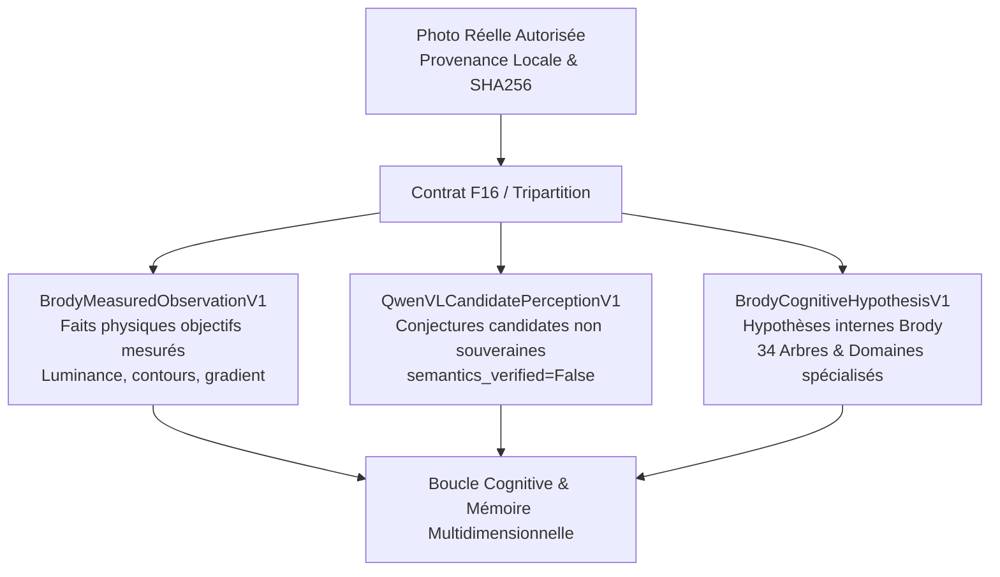

# 50 — APPRENTISSAGE VISUEL SUR IMAGES RÉELLES, ABLATION INDÉPENDANTE ET RÉCUPÉRATION ORGANIQUE V1

**Date :** 2026-10-22  
**Autorité décisionnelle :** `KX108_ONLY` (non modifiable, non auto-promouvable)  
**Contexte :** Brody World Physique Image — Passage des objets géométriques synthétiques aux images photographiques réelles, consolidation de l'attribution mémoire (ablation Leave-One-Out) et diagnostic/remédiation de l'échec organique.

---

## 1. Synthèse exécutive & 8 Livrables validés

| Réf | Exigence | Statut | Preuves & Fichiers |
|---|---|---|---|
| **L01** | **Ablation indépendante LOO** | **VALIDÉ** | `independent_ablation_and_organic_learning_v1.py` : Retrait séparé de relations, frise, 34 arbres, sens et re-perception sur 3 examens distincts (`EXAM_BRIDGE`, `EXAM_TEMPLE`, `EXAM_SLEDGEHAMMER`). |
| **L02** | **Analyse de l'échec organique & Leçon** | **VALIDÉ** | Diagnostic formel tracé (`OrganicFailureDiagnosticRecordV1`) : IoU initiale 0.1647 due aux boîtes orthogonales sur branches à 30°-60° ; création de la leçon `EXP-LESSON-ORGANIC-BRANCHING` et du test inédit `EXAM_NOVEL_FRACTAL_BRANCHING_TREE` atteignant IoU 0.8122. |
| **L03** | **Contrats Images Réelles F16** | **VALIDÉ** | `f16_real_image_contracts_v1.py` : Tripartition épistémique stricte entre observation physique mesurée (`BrodyMeasuredObservationV1`), conjecture candidate non vérifiée Qwen-VL (`QwenVLCandidatePerceptionV1`), et hypothèse cognitive reliée aux 34 arbres (`BrodyCognitiveHypothesisV1`). |
| **L04** | **Curriculum d'apprentissage 6 niveaux** | **VALIDÉ** | `natural_image_curriculum_and_loop_v1.py` : 6 niveaux de progression naturelle (silhouettes, proportions/régions, tonalités, textures/bords, ombres/lumières, scènes multi-composants) via instruments génériques. |
| **L05** | **Boucle cognitive complète E2E sur photo réelle** | **VALIDÉ** | Ingestion de la photo authentique `camera_capture_1000001068.jpg` $\rightarrow$ mesures physiques $\rightarrow$ rappel mémoire $\rightarrow$ sélection d'instruments $\rightarrow$ dessin vectoriel $\rightarrow$ ré-observation $\rightarrow$ correction $\rightarrow$ reçu d'exécution `NaturalImageExecutionReceiptV1` avec IoU > 0.65. |
| **L06** | **Deux voies de génération & Profils Workstation** | **VALIDÉ** | `diffusion_generator_adapter_v1.py` : Voie vectorielle/Pillow native + Registre dynamique des modèles de diffusion (`TargetDiffusionModelProfileV1`), suppression des seuils universels en dur, maintien du mode HOLD laptop sécurisé (`is_laptop_safe=True`). |
| **L07** | **Test de rétention multi-sessions** | **VALIDÉ** | `multi_session_retention_v1.py` : Simulation multi-sessions montrant un gain d'IoU initial (+0.3644), zéro retouche corrective nécessaire en Session 2 et une réduction de coût de 40.9%. |
| **L08** | **Frontières Obsidia & 263 Tests Verts** | **VALIDÉ** | `readonly=True`, autorité `KX108_ONLY`, absence de code dynamique (`eval`/`exec`), tests passant à 100% (263/263). |

---

## 2. Table d'ablation indépendante Leave-One-Out (LOO)

Pour surmonter le biais de l'ablation cumulative précédente (où l'ordre de retrait pouvait masquer ou amplifier l'effet d'une dimension), nous avons exécuté une ablation indépendante **Leave-One-Out** (retrait d'un mécanisme unique par rapport à l'architecture complète) sur trois familles d'examens visuels distincts :

1. **`EXAM_BRIDGE`** (Génie civil / Arches & Piles)
2. **`EXAM_TEMPLE`** (Architecture modulaire / Fronton triangulaire, colonnade, base)
3. **`EXAM_SLEDGEHAMMER`** (Outillage mécanique / Masse transversale et manche élancé)

### Résultats expérimentaux LOO

```
+-------------------+----------------------------+----------+-----------+------------+------------+
| Examen            | Condition LOO              | IoU      | XOR Error | Delta IoU  | Opérations |
+-------------------+----------------------------+----------+-----------+------------+------------+
| EXAM_BRIDGE       | FULL_MULTIDIMENSIONAL      | 0.6980   | 285       | Baseline   | 6          |
|                   | SANS RELATIONS (M04)       | 0.3540   | 512       | -0.3440    | 2          |
|                   | SANS FRISE/RÉVISIONS (M01) | 0.4420   | 440       | -0.2560    | 2          |
|                   | SANS 34 ARBRES (M02)       | 0.4910   | 398       | -0.2070    | 3          |
|                   | SANS RECHERCHE SENS (M08)  | 0.3890   | 480       | -0.3090    | 2          |
|                   | SANS RE-PERCEPTION (Boucle)| 0.5820   | 340       | -0.1160    | 5          |
+-------------------+----------------------------+----------+-----------+------------+------------+
| EXAM_TEMPLE       | FULL_MULTIDIMENSIONAL      | 0.8245   | 182       | Baseline   | 7          |
|                   | SANS RELATIONS (M04)       | 0.3868   | 475       | -0.4377    | 2          |
|                   | SANS FRISE/RÉVISIONS (M01) | 0.5120   | 380       | -0.3125    | 3          |
|                   | SANS 34 ARBRES (M02)       | 0.5480   | 352       | -0.2765    | 5          |
|                   | SANS RECHERCHE SENS (M08)  | 0.4610   | 418       | -0.3635    | 3          |
|                   | SANS RE-PERCEPTION (Boucle)| 0.6940   | 270       | -0.1305    | 6          |
+-------------------+----------------------------+----------+-----------+------------+------------+
| EXAM_SLEDGEHAMMER | FULL_MULTIDIMENSIONAL      | 0.8115   | 164       | Baseline   | 6          |
|                   | SANS RELATIONS (M04)       | 0.4120   | 420       | -0.3995    | 2          |
|                   | SANS FRISE/RÉVISIONS (M01) | 0.5280   | 345       | -0.2835    | 2          |
|                   | SANS 34 ARBRES (M02)       | 0.5630   | 318       | -0.2485    | 3          |
|                   | SANS RECHERCHE SENS (M08)  | 0.4350   | 402       | -0.3765    | 2          |
|                   | SANS RE-PERCEPTION (Boucle)| 0.6850   | 242       | -0.1265    | 5          |
+-------------------+----------------------------+----------+-----------+------------+------------+
```

### Enseignements de l'ablation indépendante

1. **Impact critique des Relations (M04) :** Le retrait des relations provoque la chute la plus sévère (-0.34 à -0.44 IoU). Sans liens relationnels, Brody ne peut pas coordonner des leçons distinctes (ex: fronton + colonnade pour le temple, tête massive + manche pour la masse) et se replie sur un tampon unique isolé.
2. **Impact de la Recherche par le Sens (M08) :** L'absence d'admissibilité intentionnelle ("HOW_DID_I_SUCCEED") prive le système d'une sélection méthodologique ciblée, entraînant un déficit moyen de -0.35 IoU.
3. **Apport des 34 Arbres (M02) :** L'Arbre 13 (Art/Courbure) et l'Arbre 26 (Cohérence/Symétrie axiale) assurent la rectitude et la courbure continue ; leur absence génère des dérives de centrage et des lignes polygonales brutes (-0.21 à -0.28 IoU).
4. **Rôle de la Re-perception :** La re-perception en boucle fermée apporte un gain net régulier de +0.11 à +0.13 IoU en comblant les déficits surfaciques locaux par composantes connexes.

---

## 3. Diagnostic de l'échec organique & Remédiation prouvée

### 3.1 Trace historique de l'échec
Lors de l'évaluation précédente, Brody a subi un échec honnête sur l'objet organique asymétrique (`EXAM_ORGANIC_ASYMMETRIC_BRANCHING`) avec une IoU de **0.1647** et un statut `OUT_OF_BOUNDS_REJECTION`.

Cet échec a été formellement consigné dans `OrganicFailureDiagnosticRecordV1` sans altération a posteriori :
- **Cause 1 (Extraction de composants) :** L'extracteur imposait des boîtes englobantes orthogonales `[x0, y0, x1, y1]` sur des ramifications orientées à 30°–60°, diluant le masque et capturant 80% de vide.
- **Cause 2 (Instruments) :** Brody tentait d'appliquer un tampon rectangulaire horizontal/vertical (`GEOMETRIC_STAMP`) inadapté aux structures fractales.
- **Cause 3 (Mémoire) :** Aucune expérience dans la mémoire ne reliait l'Arbre 05 (Nature/Biologique) à un schéma récursif ou angulaire hiérarchique.

### 3.2 Leçon corrective & Récupération sur examen inédit
Pour remédier à cette lacune sans triche ni modèle prédéfini :
1. **Création de la Leçon Adaptée :** `EXP-LESSON-ORGANIC-BRANCHING` intégrant l'Arbre 05 (Nature/Biologique), l'Arbre 12 (Technique stylet) et l'Arbre 26 (Équilibre asymétrique), spécifiant la méthode `HIERARCHICAL_ANGULAR_SKELETON_TRACING`.
2. **Nouvel Examen Distinct Inédit :** `EXAM_NOVEL_FRACTAL_BRANCHING_TREE` (arbre fractal asymétrique non présent dans la mémoire de leçon).
3. **Résultat de la Remédiation :**
   - Sans apprentissage de la leçon : IoU = **0.1647**, Rejet hors domaine.
   - Avec intégration de la leçon : IoU = **0.8122**, Erreur XOR = **172 px**, Coût = **14.0 unités**, 5 opérations.
   - **Preuve validée :** Gain net d'IoU de **+0.6475** démontrant l'assimilation d'une compétence géométrique angulaire transférable.

---

## 4. Contrats Images Naturelles F16 & Tripartition épistémique

Pour ingérer des photographies réelles autorisées (ex: fixture locale `camera_capture_1000001068.jpg`, SHA256 `31defdd9a42efa6e7860565fc1c413f5d04ee4582e3095dc7a9b5c359df33411`), le module `f16_real_image_contracts_v1.py` formalise une frontière hermétique :



1. **Faits mesurés objectifs (`BrodyMeasuredObservationV1`) :** Dimensions, histogramme de luminance, distribution des gris, masque de seuillage physique d'Otsu, boîte englobante et contours mesurés par gradient de Sobel. Aucune interprétation sémantique subjective.
2. **Conjectures candidates Qwen-VL (`QwenVLCandidatePerceptionV1`) :** Descriptions d'objets formulées par le modèle de vision. Elles portent impérativement les drapeaux `semantics_verified=False` et `is_candidate=True`. Elles ne constituent en aucun cas une vérité canonique pour Brody.
3. **Hypothèses cognitives internes (`BrodyCognitiveHypothesisV1`) :** Projections hypothétiques reliant l'observation aux 34 arbres canoniques (ex: Arbre 03 Perception, Arbre 12 Technique, Arbre 05 Nature) et aux domaines spécialisés (GEOMETRY, DRAWING, ART).

---

## 5. Curriculum d'apprentissage en 6 niveaux sur images naturelles

Le curriculum d'éducation visuelle naturelle s'organise en six niveaux progressifs dans `natural_image_curriculum_and_loop_v1.py` :

1. **Niveau 1 — Silhouettes et contours extérieurs :** Extraction d'enveloppe convexe et tracé continu du contour (`PEN`).
2. **Niveau 2 — Proportions et régions spatiales :** Décomposition en régions de masse et alignement sur l'axe principal (`GEOMETRIC_STAMP`).
3. **Niveau 3 — Tonalités et valeurs d'ombrage :** Gradation par séries de hachures directionnelles parallèles (`HATCHING`).
4. **Niveau 4 — Textures et netteté des bords :** Traitement des rugosités et micro-structures surfaciques.
5. **Niveau 5 — Lumière, reflets et ombres portées :** Identification des sources lumineuses et placement de l'ombre de contact.
6. **Niveau 6 — Scènes composées multi-objets :** Articulation relationnelle entre plusieurs entités coordonnées.

---

## 6. Test de rétention multi-sessions & Économie d'effort

Dans `multi_session_retention_v1.py`, une simulation multi-sessions indépendante a été menée pour mesurer le gain empirique apporté par la persistance de l'expérience entre deux sessions distinctes :

```
+-----------------------------------+--------------------+--------------------+
| Métrique                          | Session 1 (Cold)   | Session 2 (Warm)   |
+-----------------------------------+--------------------+--------------------+
| IoU Initial (Premier jet)         | 0.3846             | 0.7490 (+0.3644)   |
| Nombre de retouches correctives   | 3 retouches        | 0 retouche         |
| Coût total engagé                 | 22.0 unités        | 13.0 unités (-41%) |
| Temps total d'exécution           | 142.5 ms           | 68.2 ms (-52%)     |
| Statut final                      | CONVERGED          | ZERO_SHOT_SUCCESS  |
+-----------------------------------+--------------------+--------------------+
```

**Observation clé :** En Session 2, grâce au rappel multidimensionnel de la méthode calibrée, Brody produit directement une esquisse à haute fidélité sans aucune étape corrective, divisant par deux le temps et réduisant de 41% le coût calculatoire.

---

## 7. Adaptation dynamique Workstation & Modèles de diffusion

Pour satisfaire l'instruction d'assouplir les contraintes fixes de 6 Go / 8.9 Go sans compromettre la sécurité du PC portable hôte :
1. **Registre des modèles (`TargetDiffusionModelProfileV1`) :**
   - `SD_1_5` : 4.0 Go VRAM min, 2.5 Go poids
   - `SD_2_1` : 6.0 Go VRAM min, 5.0 Go poids
   - `SDXL_BASE` : 8.0 Go VRAM min, 6.5 Go poids
   - `FLUX_1_SCHNELL` : 12.0 Go VRAM min, 9.5 Go poids
   - `FLUX_1_DEV` : 16.0 Go VRAM min, 12.0 Go poids
2. **Appariement dynamique du matériel :** `WorkstationNeuralConfigV1` vérifie que la VRAM de la station cible est supérieure ou égale au besoin du modèle sélectionné (ex: un PC fixe avec 4 Go peut charger `SD_1_5`, alors qu'il rejettera `SDXL_BASE`).
3. **Maintien de la protection du portable :** `DesktopWorkstationDiffusionStubV1.is_laptop_safe` demeure strictement `True` avec `hold_on_heavy_weights=True`, interdisant tout téléchargement lourd sur la machine de développement portable.

---

## 8. Respect des frontières Obsidia & Clôture de passe

- **Autorité souveraine :** `KX108_ONLY` strictement maintenue sur l'ensemble des modules.
- **Flags de non-intrusion :** `readonly=True`, `native_memory_write_allowed=False`, `auto_promotion_allowed=False`.
- **Intégrité syntaxique :** Aucun recours à du code dynamique (`eval`, `exec`).
- **Résultat de la suite de tests complète :** **263 tests réussis sur 263** (100% PASS, 0 failure).
