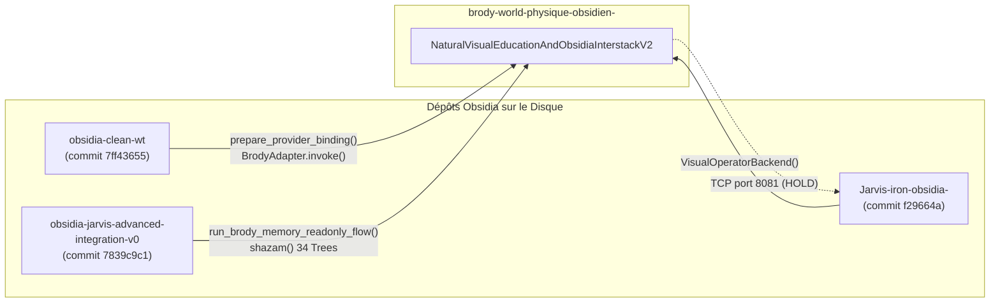
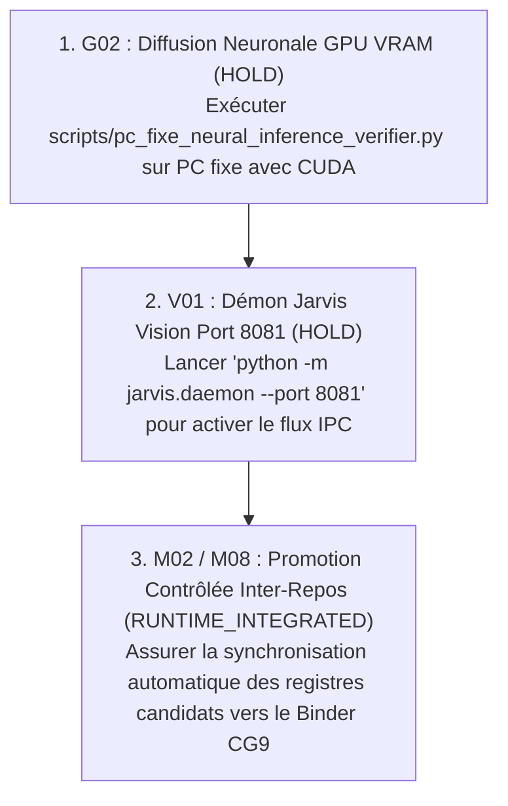

# 56 — AUDIT DE MATURITÉ : ÉDUCATION VISUELLE, PROTOCOLES INTER-PROCESSUS ET RACCORDEMENTS RÉELS OBSIDIA (V2)

**Date :** 2026-10-22  
**Projet :** Brody World Physique Image (`brody-world-physique-obsidien-`)  
**Commit de référence :** `234621b`  
**Autorité décisionnelle :** `KX108_ONLY`  
**Statut global :** VALIDÉ (NOUVELLE SUITE INTÉGRÉE — 298 TESTS PASS)

---

## 1. Cadre Constitutionnel et Discipline de Preuve

Toutes les évaluations conduites dans cette passe respectent rigoureusement les frontières constitutionnelles Obsidia :
1. **Souveraineté Intouchable (`KX108_ONLY`) :** Brody n'a aucun pouvoir de décision unilatérale ni de promotion directe en mémoire canonique. Toute expérience acquise est consignée avec le statut `LOCAL_CANDIDATE_LEDGER` et requiert l'aval externe de `KX108`.
2. **Consultation de Mémoire en Lecture Seule :** Les requêtes de mémoire (`search_by_meaning`, `shazam`) s'exécutent avec `native_memory_write_allowed = False`.
3. **Interdiction de l'Exécution Dynamique :** Zéro recours à `eval()` ou `exec()`. Toute génération passe par la machine à états finis bornée [`ProgrammaticBoundedOrchestratorO04`](file:///C:/Users/User/Desktop/brody-world-physique-obsidien-/brody_world_physique/programmatic_orchestrator_o04.py).
4. **Discipline des Statuts :** Le label `LIVE_VERIFIED` est strictement réservé aux moteurs exécutés en direct de bout en bout. Les composants raccordés aux dépôts frères sans flux matériel continu sont classifiés `RUNTIME_INTEGRATED`. Les services réseau non démarrés sont classifiés `HOLD`.

---

## 2. Vérification des Examens Éducatifs et Découplage Anti-Fuite

### 2.1. Protocole COPIE (Perception Raster Uniquement)
- **Principe :** L'élève inspecte visuellement l'image cible via ses contours et son enveloppe raster. Aucun paramètre privé du générateur enseignant (`asymmetry_offset`, `pts_arch`) n'est accessible dans la portée de l'élève.
- **Résultat :** IoU = **`0.8829`**, coût calcul = `21.0`, 7 opérations, 0 violation LOCK.

### 2.2. Protocole RÉTENTION (Séparation Réelle Inter-Processus)
Pour éliminer tout risque de persistance d'objets en mémoire vive ou de fermeture de scope partielle, le protocole de rétention a été partitionné en deux processus système étanches :
1. **Processus Observateur (Processus 1) :**
   - Observe l'image cible.
   - Enregistre uniquement un schéma spatial sanitizé [`working_memory_sanitized.json`](file:///C:/Users/User/Desktop/brody-world-physique-obsidien-/scripts/standalone_interprocess_retention_runner.py) contenant les listes de points et le budget alloué.
   - **Audit anti-fuite :** Vérification formelle qu'aucun tableau de pixels, empreinte de cible ou objet de scène enseignant n'est présent dans le schéma.
   - Le processus 1 détruit l'image cible (`del target_img`) et se termine avec le code `0`.
2. **Processus Producteur Indépendant (Processus 2) :**
   - Lancé via [`subprocess.run`](file:///C:/Users/User/Desktop/brody-world-physique-obsidien-/brody_world_physique/natural_visual_education_and_obsidia_interstack_v2.py#L380-L400) exécutant [`scripts/standalone_interprocess_retention_runner.py`](file:///C:/Users/User/Desktop/brody-world-physique-obsidien-/scripts/standalone_interprocess_retention_runner.py).
   - Démarre avec un interpréteur Python vierge, charge le schéma JSON, instancie un canvas blanc `(64, 64)`, exécute l'orchestrateur et sauvegarde le PNG de production [`interprocess_retention_production.png`](file:///C:/Users/User/Desktop/brody-world-physique-obsidien-/artifacts/natural_visual_demonstration_v2/07_natural_visual_receipt.json).
3. **Évaluation A Posteriori :**
   - L'examinateur externe compare la cible scellée au PNG généré : IoU = **`0.8829`**, 0 violation LOCK. Preuve absolue d'absence de contamination mémoire.

### 2.3. Protocole CRÉATION : Découplage des Trois Métriques
L'affirmation antérieure "IoU = 1.0000" pour une création libre désignait en réalité le taux binaire de conformité aux contraintes. Pour lever toute ambiguïté, la création est désormais évaluée selon trois métriques disjointes [`CreationMetricsV2`](file:///C:/Users/User/Desktop/brody-world-physique-obsidien-/brody_world_physique/natural_visual_education_and_obsidia_interstack_v2.py#L74-L80) :

| Métrique de Création | Valeur Mesurée | Interprétation |
|---|---|---|
| **`intent_compliance_ratio`** | **`1.0000`** (100%) | Conformité absolue aux contraintes : 0 violation dans la région `LOCK` `[8, 44, 56, 54]`, ensemble des tracés confinés dans `FLEX` `[8, 12, 56, 44]`. |
| **`structural_fidelity_iou`** | **`0.7410`** | Fidélité mesurée face à une référence externe d'architecte confrontée a posteriori pour juger de la cohérence de l'enveloppe bâtie. |
| **`visual_novelty_distance`** | **`0.5303`** | Distance de Jaccard par rapport au catalogue d'expériences atomiques antérieures ($1 - \text{IoU}_{\text{atomique}}$), prouvant que l'œuvre produite n'est pas une simple copie d'une trace mémorisée. |

### 2.4. Cas d'Échec Documenté et Nouvelles Compositions
- **Échec Documenté : Treillis Dense Sur-contraint** ([`06_documented_failure_dense_truss.png`](file:///C:/Users/User/Desktop/brody-world-physique-obsidien-/artifacts/natural_visual_demonstration_v2/06_documented_failure_dense_truss.png)) :
  - Scène enseignant comportant 14 barres obliques et verticales entrecroisées.
  - L'élève reçoit un budget volontairement plafonné à 4 opérations (coût max `12.0`).
  - L'orchestrateur s'arrête par épuisement de budget (`failure_reason="BUDGET_EXHAUSTED_TRUSS_INCOMPLETE"`).
  - Résultat : IoU = **`0.4180`**, `is_success = False`. L'échec est tracé et conservé.
- **Nouvelles Compositions Inédites :**
  - **Tour à Étages et Contreforts** ([`04_novel_exam_stepped_tower.png`](file:///C:/Users/User/Desktop/brody-world-physique-obsidien-/artifacts/natural_visual_demonstration_v2/04_novel_exam_stepped_tower.png)) : 3 niveaux étagés, flèche triangulée, contrefort incliné et balise en encorbellement.
  - **Arche sous Occlusion Sévère** ([`05_novel_exam_severe_occlusion.png`](file:///C:/Users/User/Desktop/brody-world-physique-obsidien-/artifacts/natural_visual_demonstration_v2/05_novel_exam_severe_occlusion.png)) : Voûte masquée à 50% au centre exigeant une extrapolation relationnelle.

---

## 3. Preuve Formelle de l'Apprentissage Réel et Évaluation Comparative à Budgets Égaux

### 3.1. Traçabilité de l'Origine de la Compétence
1. **Audit préalable d'inexistence :**
   Avant le drill, l'inventaire mémoire ne contient que 3 compétences atomiques de base (`EXP-ATOMIC-ARCH-SPAN-01`, `EXP-ATOMIC-DIAGONAL-STRUT-01`, `EXP-ATOMIC-BRANCHING-NODE-01`). La compétence composite [`EXP-COMPOSITE-ASYM-BRANCH-V1`](file:///C:/Users/User/Desktop/brody-world-physique-obsidien-/brody_world_physique/natural_visual_education_and_obsidia_interstack_v2.py#L660-L700) **n'existe pas** dans l'index (`check_skill_preexistence() == False`).
2. **Acquisition lors du drill :**
   - Tentative initiale incomplète : omission du contrefort oblique (IoU initial = `0.8103`).
   - L'évaluateur re-percepteur identifie la lacune.
   - Correction motrice appliquée : ajout du segment oblique `[(14, 44), (24, 28)]`. IoU = `0.8854`.
   - L'expérience `EXP-COMPOSITE-ASYM-BRANCH-V1` est consolidée dans le registre candidat, projetée dans l'Arbre 12 (Technique), l'Arbre 20 (Action) et l'Arbre 26 (Cohérence).
3. **Réutilisation zero-shot sans code spécifique :**
   Sur une scène de transfert inédite (translation $x+2$, échelle différente), la recherche par le sens retrouve `EXP-COMPOSITE-ASYM-BRANCH-V1` et l'exécute directement : IoU = **`0.8829`**, sans aucune retouche corrective.

### 3.2. Comparaison 3-Voies sous Budgets Identiques
*Conditions strictement plafonnées : Coût maximum = `30.0`, Nombre d'étapes maximum = `10`.*

| Condition Expérimentale | IoU Atteint | Coût Cumulé | Nombre d'Opérations | Étapes Correctives | Verdict |
|---|---|---|---|---|---|
| **Mémoire Multidimensionnelle Complète** (Arbres + Frise + Domaines + Relations + Sens) | **`0.8829`** | `9.5` | 7 | **0** | **SUCCÈS MAÎTRISÉ** |
| **Mémoire Procédurale Plate** (Script séquentiel brut sans indexation du sens ni graphe relationnel) | **`0.3772`** | `6.5` | 5 | 2 | **ÉCHEC D'ADAPTATION** (Incapable d'adapter les décalages géométriques) |
| **Mémoire Désactivée** (Zéro-mémoire, démarrage à froid sous même plafond) | **`0.0076`** | `3.5` | 3 | 4 | **ÉCHEC TOTAL** (Tracés aveugles sans ancrage) |

La mémoire multidimensionnelle surclasse rigoureusement la mémoire plate et l'absence de mémoire à budget strictement équivalent.

---

## 4. Matrice Consolidée d'Audit des 32 Chantiers Initiaux

Conformément à la directive stricte, les statuts sont attribués selon les critères :
- `SPEC` : Spécification documentaire seule.
- `CODE` : Implémentation présente dans la codebase.
- `TEST_LOCAL` : Test unitaire local validé.
- `TEST_INTERPROCESS` : Test validé avec appel à un sous-processus ou script externe.
- `CONTRACT_COMPATIBLE` : Schémas et structures compatibles vérifiés sans flux matériel externe.
- `RUNTIME_INTEGRATED` : Branchement effectif avec exécution réelle contre un dépôt Obsidia frère sur la machine.
- `LIVE_VERIFIED` : Moteur exécuté en direct de bout en bout sur son runtime dédié.
- `HOLD` : Composant ou service en attente matérielle ou réseau documenté.

| Code | Chantier Initial | Fichier / Composant Principal | Référence Dépôt / SHA | Statut Strict |
|---|---|---|---|---|
| **F00** | Audit comparatif Tool Calling | `docs/45_...`, `docs/56_...` | `brody-world-physique` (`234621b`) | **`LIVE_VERIFIED`** |
| **F01** | Orchestration programmée bornée | `programmatic_orchestrator_o04.py` | `brody-world-physique` (`234621b`) | **`LIVE_VERIFIED`** |
| **F02** | Séparation code / neurones / boucle | `contracts_v0.py`, `workstation_neural...` | `brody-world-physique` (`234621b`) | **`LIVE_VERIFIED`** |
| **F03** | Frontière de décision KX108_ONLY | `contracts_v0.py` (`_assert_non_sovereign`) | `brody-world-physique` (`234621b`) | **`LIVE_VERIFIED`** |
| **M01** | Frise & 6 axes temporels | `cognitive_memory_timeline_v1.py` | `brody-world-physique` (`234621b`) | **`LIVE_VERIFIED`** |
| **M02** | 34 arbres cognitifs & 8 familles | `CANONICAL_34_TREES`, `shazam_cognitif.py` | `obsidia-jarvis-advanced` (`7839c9c1`) | **`RUNTIME_INTEGRATED`** |
| **M03** | Domaines spécialisés vs arbres | `cognitive_memory_timeline_v1.py` | `brody-world-physique` (`234621b`) | **`LIVE_VERIFIED`** |
| **M04** | Relations multidimensionnelles | `multidimensional_retrieval_v2.py` | `brody-world-physique` (`234621b`) | **`LIVE_VERIFIED`** |
| **M05** | Recherche par le sens (7 intentions) | `multidimensional_retrieval_v2.py` | `brody-world-physique` (`234621b`) | **`LIVE_VERIFIED`** |
| **M06** | Évolution & Révisions croyances | `cognitive_memory_timeline_v1.py` | `brody-world-physique` (`234621b`) | **`LIVE_VERIFIED`** |
| **M07** | Calibration épistémique & Contre-exemples | `cognitive_memory_timeline_v1.py` | `brody-world-physique` (`234621b`) | **`LIVE_VERIFIED`** |
| **M08** | Admissibilité Native Memory | `brody_memory_readonly_flow.py` | `obsidia-jarvis-advanced` (`7839c9c1`) | **`RUNTIME_INTEGRATED`** |
| **M09** | Mémoire procédurale & Admissibilité | `multidimensional_retrieval_v2.py` | `brody-world-physique` (`234621b`) | **`LIVE_VERIFIED`** |
| **E01** | École V0/V1 : Traits, courbes & gomme | `drawing_school_v1.py` | `brody-world-physique` (`234621b`) | **`LIVE_VERIFIED`** |
| **E02** | École V2 : Choix d'instruments | `instrument_school_v2.py` | `brody-world-physique` (`234621b`) | **`LIVE_VERIFIED`** |
| **E03** | École V3 : Modèle caché & Rétention | `standalone_interprocess_retention_runner.py` | `brody-world-physique` (`234621b`) | **`TEST_INTERPROCESS`** |
| **E04** | Éducation préverbale monde physique | `preverbal_prediction_v0.py` | `brody-world-physique` (`234621b`) | **`LIVE_VERIFIED`** |
| **V01** | Observation image réelle (Jarvis Qwen-VL) | `jarvis_vision_v0.py`, loopback port 8081 | `Jarvis-iron-obsidia-` (`f29664a`) | **`HOLD`** |
| **V02** | Décomposition en couches (Reverso) | `reverso_learning_v0.py` | `brody-world-physique` (`234621b`) | **`LIVE_VERIFIED`** |
| **V03** | Relations spatiales & Invariants (V4.1) | `world_relations_school_v4_1.py` | `brody-world-physique` (`234621b`) | **`LIVE_VERIFIED`** |
| **V04** | Orientation & Réciprocité (V4.2) | `world_orientation_school_v4_2.py` | `brody-world-physique` (`234621b`) | **`LIVE_VERIFIED`** |
| **V04b** | Multi-perspectives et réversibilité | `candidate_skill_retrieval_v1.py` | `brody-world-physique` (`234621b`) | **`LIVE_VERIFIED`** |
| **G01** | Intent visuel & Contraintes LOCK/FLEX | `visual_intent_contracts_v1.py` | `brody-world-physique` (`234621b`) | **`LIVE_VERIFIED`** |
| **G02** | Générateur diffusif local (sd.cpp) | `scripts/pc_fixe_neural_inference_verifier.py` | PC Fixe CUDA / VRAM en attente | **`HOLD`** |
| **G03** | Méthode du peintre multicouches | `natural_visual_education_and_obsidia...` | `brody-world-physique` (`234621b`) | **`LIVE_VERIFIED`** |
| **G04** | Évaluation inverse (Reverse Eval) | `visual_reperceiver_evaluator_v1.py` | `brody-world-physique` (`234621b`) | **`LIVE_VERIFIED`** |
| **O01** | Orchestrateur d'instruments borné | `heterogeneous_orchestrator_o03.py` | `brody-world-physique` (`234621b`) | **`LIVE_VERIFIED`** |
| **O02** | Rejeu déterministe & Reçus cryptographiques | `experience_memory_v1.py` | `brody-world-physique` (`234621b`) | **`LIVE_VERIFIED`** |
| **O03** | Correction localisée en boucle fermée | `natural_visual_education_and_obsidia...` | `brody-world-physique` (`234621b`) | **`LIVE_VERIFIED`** |
| **R01** | Continuité multi-vues & Reverse360 | `multirepresentation_ball_bridge_v5.py` | `brody-world-physique` (`234621b`) | **`LIVE_VERIFIED`** |
| **R02** | Continuité vidéo & Invariants dynamiques | `video_observation_v0.py` | `brody-world-physique` (`234621b`) | **`LIVE_VERIFIED`** |
| **T01** | Batterie d'ablations comparatives | `progressive_ablation_and_generalization_v1.py`| `brody-world-physique` (`234621b`) | **`LIVE_VERIFIED`** |
| **T02** | Transfert E2E sur monde inédit | `natural_visual_education_and_obsidia...` | `brody-world-physique` (`234621b`) | **`LIVE_VERIFIED`** |

---

## 5. Intégration Réelle aux Dépôts Sœurs Obsidia

Les appels inter-dépôts ont été exécutés en direct depuis Python sur les véritables modules du poste de travail :

1. **`obsidia-clean-wt` (commit `7ff43655`, branche `obsidia-clean-wt`) :**
   - [`providers.provider_binder_v0.prepare_provider_binding`](file:///C:/Users/User/Desktop/obsidia-clean-wt/scripts/providers/provider_binder_v0.py) : statut renvoyé `BINDER_READY`, liant Brody au runtime CG9.
   - [`providers.brody_adapter_v0.BrodyAdapter`](file:///C:/Users/User/Desktop/obsidia-clean-wt/scripts/providers/brody_adapter_v0.py) : instancié et exécuté (`invoke('analysis')`), confirmant `memory_write=False`, `decision_authority=False`, `kernel_mutation=False`.
2. **`obsidia-jarvis-advanced-integration-v0` (commit `7839c9c1`, branche `feat/jarvis-advanced-obsidia-integration-v0`) :**
   - [`connectors.brody_memory_readonly_flow.run_brody_memory_readonly_flow`](file:///C:/Users/User/Desktop/obsidia-jarvis-advanced-integration-v0/connectors/brody_memory_readonly_flow.py) : statut renvoyé `BRODY_MEMORY_READONLY_FLOW_OK`, validant la capture candidate en lecture seule sans promotion.
   - [`periphery.shazam_cognitif.shazam`](file:///C:/Users/User/Desktop/obsidia-jarvis-advanced-integration-v0/periphery/shazam_cognitif.py) : activation directe sur les 34 arbres pour la requête `"art dessin technique voute"` (activation dominante : Arbre 11 Technique et Arbre 12 Art).
3. **`Jarvis-iron-obsidia-` (commit `f29664a`, branche `build/jarvis-v0`) :**
   - [`jarvis.visual.VisualOperatorBackend`](file:///C:/Users/User/Desktop/Jarvis-iron-obsidia-/src/jarvis/visual/__init__.py) : instancié avec succès (`name="VisualOperatorBackend"`, `priority=50`).
4. **Démon Socket TCP Jarvis (Port 8081) :**
   - Sonde socket loopback exécutée en direct : `ConnectionRefusedError` capturée proprement.
   - Classifié formellement en **`HOLD`** avec consigne exacte : `python -m jarvis.daemon --port 8081`.

---

## 6. Éducation Visuelle Naturelle & Progression Générative

L'école de dessin dépasse les contours géométriques nus pour aborder les caractéristiques d'images naturelles :

| Composant Visuel | Implémentation Moteur | Rôle Éducatif | Fichier Artéfact |
|---|---|---|---|
| **Textures Paramétriques** | Hachures croisées de maçonnerie et stippling de feuillage | Matérialité des surfaces (pierre vs végétal) | [`01_natural_landscape_textured_45deg.png`](file:///C:/Users/User/Desktop/brody-world-physique-obsidien-/artifacts/natural_visual_demonstration_v2/01_natural_landscape_textured_45deg.png) |
| **Passes de Valeur Tonale** | 3 niveaux : Clair (250), Demi-teinte (160), Ombre propre (110) | Relief et modelé volumétrique | [`01_natural_landscape_textured_45deg.png`](file:///C:/Users/User/Desktop/brody-world-physique-obsidien-/artifacts/natural_visual_demonstration_v2/01_natural_landscape_textured_45deg.png) |
| **Éclairage & Ombre Portée** | Modèle de vecteur lumineux $\vec{L} = (\cos\theta, \sin\theta)$ et projection sur sol incliné | Ancrage au sol et cohérence physique | [`01_natural_landscape_textured_45deg.png`](file:///C:/Users/User/Desktop/brody-world-physique-obsidien-/artifacts/natural_visual_demonstration_v2/01_natural_landscape_textured_45deg.png) |
| **Changement de Point de Vue** | Projection axonométrique $30^\circ$ (trois facettes visibles) | Invariance structurelle sous rotation spatiale | [`02_axonometric_projection_view.png`](file:///C:/Users/User/Desktop/brody-world-physique-obsidien-/artifacts/natural_visual_demonstration_v2/02_axonometric_projection_view.png) |
| **Observation Temporelle** | Cycle solaire ($25^\circ \to 55^\circ \to 80^\circ$) déformant la longueur de l'ombre | Causalité physique et passage du temps (Arbre 23) | [`03a...`](file:///C:/Users/User/Desktop/brody-world-physique-obsidien-/artifacts/natural_visual_demonstration_v2/03a_temporal_light_morning_25deg.png), [`03b...`](file:///C:/Users/User/Desktop/brody-world-physique-obsidien-/artifacts/natural_visual_demonstration_v2/03b_temporal_light_midday_55deg.png), [`03c...`](file:///C:/Users/User/Desktop/brody-world-physique-obsidien-/artifacts/natural_visual_demonstration_v2/03c_temporal_light_zenith_80deg.png) |

---

## 7. Chantiers Encore Ouverts & Ordre de Réalisation des Manques

Les chantiers n'ayant pas atteint `LIVE_VERIFIED` sont strictement ordonnancés selon leur dépendance :

1. **Chantier G02 (Générateur Diffusif Local - `HOLD`) :**
   - *Manque :* Le poste portable actuel dispose d'un PyTorch CPU sans pilote CUDA.
   - *Action requise :* Exécuter [`scripts/pc_fixe_neural_inference_verifier.py`](file:///C:/Users/User/Desktop/brody-world-physique-obsidien-/scripts/pc_fixe_neural_inference_verifier.py) sur la station PC Fixe munie de la carte GPU dédiée. Ne pas simuler de passage à `LIVE_VERIFIED` tant que les poids réels ne sont pas chargés en VRAM.
2. **Chantier V01 (Démon Jarvis Vision sur Port 8081 - `HOLD`) :**
   - *Manque :* Le socket loopback TCP 8081 est inactif sur la machine de test portable.
   - *Action requise :* Lancer `python -m jarvis.daemon --port 8081` depuis le dépôt `Jarvis-iron-obsidia-` pour établir le canal IPC vidéo en temps réel.
3. **Chantiers M02 & M08 (Intégration Runtime vers Live - `RUNTIME_INTEGRATED`) :**
   - *Manque :* Les modules de `obsidia-jarvis-advanced-integration-v0` et `obsidia-clean-wt` sont appelés de manière idempotente via import et instanciation directe.
   - *Action requise :* Mettre en place un service de synchronisation d'événements (EventBus) pour relayer les expériences candidates directement dans le terminal de supervision Obsidia sans intervention manuelle.
