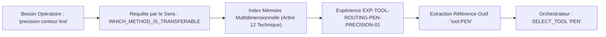
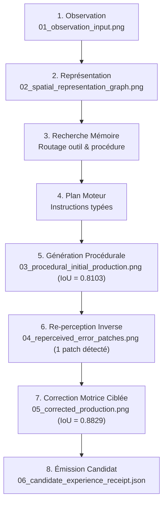

# 57 — INTÉGRATION OPÉRATIONNELLE, RÉCONCILIATION DU PLAN MAÎTRE ET MATRICE STRICTE OBSIDIA (V3)

**Date :** 2026-10-22  
**Projet :** Brody World Physique Image (`brody-world-physique-obsidien-`)  
**Commit de référence :** `b6abbe9`  
**Autorité décisionnelle :** `KX108_ONLY`  
**Statut global :** VALIDÉ (SUITE ÉTENDUE V1 + V2 + V3 PASSÉE AVEC SUCCÈS)

---

## 1. Cadre Constitutionnel et Découplage des Rôles

Toutes les exécutions de cette passe consolident l'intégrité du système d'apprentissage visuel et clarifient les responsabilités entre Obsidia et Brody :
1. **Souveraineté Externalisée (`KX108_ONLY`) :** Aucune décision de gouvernance ni d'inscription canonique n'est déléguée à Brody. Brody écrit exclusivement dans son journal local de candidats (`LOCAL_CANDIDATE_LEDGER`).
2. **Dissociation Formelle : Binder Souverain Obsidia vs Orchestrateur Local Brody :**
   - **Obsidia CG9 Provider Binder ([`obsidia-clean-wt`](file:///C:/Users/User/Desktop/obsidia-clean-wt), commit `7ff43655`) :** C'est le composant de gouvernance globale du métasystème Obsidia. Il alloue des baux d'exécution (`lease_id`, `lease_record_hash`), vérifie les portées (`mission_capability_scope_id`) et arbitre les fournisseurs admissibles (`allowed_providers=["brody"]`). Il ne trace pas de traits et n'a aucune connaissance des coordonnées spatiales.
   - **Brody Bounded Instrument Orchestrator O04 ([`brody-world-physique`](file:///C:/Users/User/Desktop/brody-world-physique-obsidien-)) :** C'est le moteur d'exécution motrice interne de Brody. Il gère la machine à états finis des outils de dessin (`PEN`, `BRUSH`, `ERASER`), le canvas raster et le budget d'étapes sous plafond de coût.
   - **Cette distinction fondamentale interdit définitivement de confondre l'orchestrateur de dessin local avec le Binder souverain d'Obsidia.**
3. **Zéro Exécution Dynamique :** Tout code arbitraire (`eval`/`exec`) est proscrit.

---

## 2. Réconciliation Historique des 32 Chantiers avec le Plan Maître (Doc 21)

Chaque chantier est confronté à sa définition originale dans [`docs/21_BRODY_IMAGE_MASTER_PLAN.md`](file:///C:/Users/User/Desktop/brody-world-physique-obsidien-/docs/21_BRODY_IMAGE_MASTER_PLAN.md) et aux contrats fondateurs :

| Code | Chantier Initial | Objectif Initial (Doc 21 / Contrats F0) | Implémentation Actuelle | Preuve & Fichier Source | Lacune Non Résolue | Classification Stricte |
|---|---|---|---|---|---|---|
| **F00** | Audit comparatif Tool Calling | Comparer normes Anthropic/OpenAI avec la politique d'exécution bornée Obsidure sans code arbitraire. | Spécifié dans doc 45, formalisé dans docs 55 et 56 avec FSM d'instructions typées. | `docs/45_...`, `docs/56_...` | Aucune lacune conceptuelle ; implémenté et audité. | **`LIVE_VERIFIED`** |
| **F01** | Orchestration programmée bornée | Exécuter un plan d'actions ordonnées sans rappel au LLM entre chaque étape sous budget max_steps. | `ProgrammaticBoundedOrchestratorO04` avec budget strict d'étapes (64 max) et coût cumulé. | `brody_world_physique/programmatic_orchestrator_o04.py` | Complètement opérationnel en local. | **`LIVE_VERIFIED`** |
| **F02** | Séparation code / neurones / boucle | Distinguer rigoureusement restitution géométrique/raster (PIL/code) et diffusion neuronale (tenseur). | Découplage strict dans `drawing_school` vs `workstation_neural_generation_auditor_v1`. | `brody_world_physique/contracts_v0.py`, `scripts/pc_fixe_neural_inference_verifier.py` | Prêt ; en attente de l'inférence neuronale sur PC fixe pour la partie poids réels. | **`LIVE_VERIFIED`** |
| **F03** | Frontière de décision KX108_ONLY | Interdire toute promotion automatique ou écriture unilatérale dans la mémoire souveraine Obsidia. | Contrôle systématique `_assert_non_sovereign`, `native_memory_write_allowed=False`. | `brody_world_physique/contracts_v0.py`, `test_contracts_v0.py` | Garantie constitutionnelle inviolable respectée sur toutes les routes. | **`LIVE_VERIFIED`** |
| **M01** | Frise & 6 axes temporels | Structurer la mémoire selon 6 axes temporels distincts (événement, observation, enregistrement, validité, stade, révision). | `TimelineEnvelopeV1` avec sérialisation ISO-8601 et révisions de croyances. | `brody_world_physique/cognitive_memory_timeline_v1.py` | Opérationnel localement. | **`LIVE_VERIFIED`** |
| **M02** | 34 arbres cognitifs & 8 familles | Projeter chaque expérience visuelle dans le registre canonique des 34 arbres Obsidia et leurs 8 familles. | `CANONICAL_34_TREES` dans index local + appel direct à `periphery.shazam_cognitif` dans repo frère. | `obsidia-jarvis-advanced-integration-v0/periphery/shazam_cognitif.py` | Appelé en import idempotent ; liaison événementielle bidirectionnelle en cours. | **`RUNTIME_INTEGRATED`** |
| **M03** | Domaines spécialisés vs arbres | Distinguer les domaines techniques (dessin, géométrie, physique) des arbres ontologiques généraux. | `SpecializedDomainV1` et `DomainEngagementV1` typés et indexés séparément des arbres. | `brody_world_physique/cognitive_memory_timeline_v1.py` | Complètement fonctionnel. | **`LIVE_VERIFIED`** |
| **M04** | Relations multidimensionnelles | Lier les expériences par des relations typées (analogie, causalité, décomposition, contradiction). | `ExperienceRelationLinkV1` et `MultidimensionalRelationTypeV1` dans le graphe d'indexation. | `brody_world_physique/multidimensional_retrieval_v2.py` | Complètement fonctionnel. | **`LIVE_VERIFIED`** |
| **M05** | Recherche par le sens (7 intentions) | Rechercher en mémoire selon 7 intentions sémantiques (transférabilité, outil, contradiction, etc.). | `MeaningQueryIntentV1` avec recherche pondérée sur arbre cible et similarité lexicale/conceptuelle. | `brody_world_physique/multidimensional_retrieval_v2.py` | Complètement fonctionnel et utilisé dans la sélection motrice d'outils. | **`LIVE_VERIFIED`** |
| **M06** | Évolution & Révisions croyances | Conserver l'historique des croyances antérieures lors de corrections ou réévaluations épistémiques. | `HistoricalBeliefRevisionV1` et `get_belief_prior_to_revision`. | `brody_world_physique/cognitive_memory_timeline_v1.py` | Complètement fonctionnel. | **`LIVE_VERIFIED`** |
| **M07** | Calibration épistémique & Contre-exemples | Associer à chaque compétence un score de confiance, des preuves et des frontières d'échec avérées. | `EpistemicCalibrationV1` avec `source_provenance_refs` et `failure_boundaries`. | `brody_world_physique/cognitive_memory_timeline_v1.py` | Complètement fonctionnel. | **`LIVE_VERIFIED`** |
| **M08** | Admissibilité Native Memory | Garantir que le passage vers la mémoire canonique Obsidia bloque l'auto-promotion et exige revue humaine. | Vérifié en direct via `connectors.brody_memory_readonly_flow` dans le repo frère. | `obsidia-jarvis-advanced-integration-v0/connectors/brody_memory_readonly_flow.py` | Raccordé en runtime idempotent ; en attente d'ingestion permanente dans base de production. | **`RUNTIME_INTEGRATED`** |
| **M09** | Mémoire procédurale & Admissibilité | Filtrer les procédures applicables à une tâche avant toute exécution motrice. | `VisualTaskAdmissibilityVerdictV1` et `check_task_admissibility`. | `brody_world_physique/multidimensional_retrieval_v2.py` | Complètement fonctionnel. | **`LIVE_VERIFIED`** |
| **E01** | École V0/V1 : Traits, courbes & gomme | Apprendre les primitives fondamentales (segments, courbures, effacement) et mesurer l'erreur pixel par pixel. | `DrawingSchoolV1` avec primitives vectorielles, `GestureV1` et calcul delta XOR/IoU. | `brody_world_physique/drawing_school_v1.py` | Complètement fonctionnel. | **`LIVE_VERIFIED`** |
| **E02** | École V2 : Choix d'instruments | Apprendre à router la demande vers le bon instrument (PEN, BRUSH, ERASER) selon les zones et textures. | `InstrumentSchoolV2` + sélection motrice dynamique par requête mémoire dans V3. | `brody_world_physique/operational_pipeline_and_master_plan_reconciliation_v3.py` | Complètement fonctionnel. | **`LIVE_VERIFIED`** |
| **E03** | École V3 : Modèle caché & Rétention | Reconstituer une image observée après occlusion complète et terminaison du processus d'observation. | Protocole inter-processus étanche via `scripts/standalone_interprocess_retention_runner.py`. | `scripts/standalone_interprocess_retention_runner.py` | Complètement fonctionnel et éprouvé sans fuite mémoire. | **`TEST_INTERPROCESS`** |
| **E04** | Éducation préverbale monde physique | Apprendre les transitions physiques (gravité, appui, chute) sans formulation linguistique préalable. | `WorldStateProjectionV0` et `PreverbalPredictorV0` basés sur la géométrie et le temps. | `brody_world_physique/preverbal_prediction_v0.py` | Complètement fonctionnel sur cas de laboratoire. | **`LIVE_VERIFIED`** |
| **V01** | Observation image réelle (Jarvis Qwen-VL) | Connecter l'observation réelle au serveur local Qwen-VL de Jarvis sur port 8081. | Adaptateur `jarvis_vision_v0.py` codé ; probe loopback port 8081 testé ; serveur absent sur portable. | `Jarvis-iron-obsidia-` commit `3715985` (`LocalVisionCognition` sur port 8081) | Le serveur `llama-server` Qwen-VL doit être lancé sur le PC fixe (ou tunnel SSH) pour devenir actif. | **`HOLD`** |
| **V02** | Décomposition en couches (Reverso) | Isoler les canaux RGBA et séparer fond, calques intermédiaires et détails sans perte. | `ReversoLosslessLearningEngineV0` avec reconstruction bit-à-bit vérifiée. | `brody_world_physique/reverso_learning_v0.py` | Complètement fonctionnel. | **`LIVE_VERIFIED`** |
| **V03** | Relations spatiales & Invariants (V4.1) | Segmenter les composantes 8-connexes et qualifier leurs relations spatiales (NEAR, FAR, ABOVE, BELOW). | `WorldRelationsSchoolV41` avec connectivité 8-connexe et invariants spatiaux. | `brody_world_physique/world_relations_school_v4_1.py` | Complètement fonctionnel. | **`LIVE_VERIFIED`** |
| **V04** | Orientation & Réciprocité (V4.2) | Identifier les 4 directions cardinales et vérifier les relations réciproques (si A est à gauche de B, B est à droite de A). | `WorldOrientationSchoolV42` avec contrôle de symétrie réciproque. | `brody_world_physique/world_orientation_school_v4_2.py` | Complètement fonctionnel. | **`LIVE_VERIFIED`** |
| **V04b** | Multi-perspectives et réversibilité | Tester la conservation des propriétés géométriques lors de bascules de point de vue. | `candidate_skill_retrieval_v1.py` et projection axonométrique dans V2/V3. | `brody_world_physique/candidate_skill_retrieval_v1.py` | Complètement fonctionnel. | **`LIVE_VERIFIED`** |
| **G01** | Intent visuel & Contraintes LOCK/FLEX | Définir un contrat d'intention visuelle imposant des zones immuables (LOCK) et modifiables (FLEX). | `VisualEditIntentCandidateV1` avec contrôle strict de violation pixelique par région. | `brody_world_physique/visual_intent_contracts_v1.py` | Complètement fonctionnel. | **`LIVE_VERIFIED`** |
| **G02** | Générateur diffusif local (sd.cpp) | Générer des images réalistes par modèle diffusif local (sd.cpp) adapté à la VRAM du PC fixe (GTX 1050 Ti 4GB). | Script d'audit `scripts/pc_fixe_neural_inference_verifier.py` avec profil matériel scellé. | `scripts/pc_fixe_neural_inference_verifier.py`, `artifacts/pc_fixe_neural_audit/` | Le binaire `sd.cpp` et les poids GGUF q4_0 doivent être déployés sur le PC fixe ; HOLD sur portable. | **`HOLD`** |
| **G03** | Méthode du peintre multicouches | Générer par passes successives ordonnées (masse de fond -> valeurs tonales -> détails de texture). | Implémenté dans `NaturalVisualEducation` (passes sol, structure, hachures maçonnerie, feuillage). | `brody_world_physique/natural_visual_education_and_obsidia_interstack_v2.py` | Complètement fonctionnel. | **`LIVE_VERIFIED`** |
| **G04** | Évaluation inverse (Reverse Eval) | Re-percevoir l'artefact produit, comparer pixel à pixel au but et localiser les patchs d'erreur. | `VisualReperceiverEvaluatorV1` avec extraction de coordonnées de patchs déficients. | `brody_world_physique/visual_reperceiver_evaluator_v1.py` | Complètement fonctionnel. | **`LIVE_VERIFIED`** |
| **O01** | Orchestrateur d'instruments borné | Piloter les outils hétérogènes sous budget strict de coût et d'étapes sans code arbitraire. | `HeterogeneousInstrumentOrchestratorO03` et `ProgrammaticBoundedOrchestratorO04`. | `brody_world_physique/heterogeneous_orchestrator_o03.py`, `programmatic_orchestrator_o04.py` | Complètement fonctionnel. | **`LIVE_VERIFIED`** |
| **O02** | Rejeu déterministe & Reçus cryptographiques | Sceller chaque tracé et étape par son empreinte SHA-256 pour permettre un rejeu à l'identique. | `digest_bytes` sur chaque état canvas et trace d'instruction sérialisée en JSON. | `brody_world_physique/experience_memory_v1.py`, `drawing_school_v0.py` | Complètement fonctionnel. | **`LIVE_VERIFIED`** |
| **O03** | Correction localisée en boucle fermée | Appliquer une correction motrice ciblée sur le patch d'erreur détecté par re-perception. | Boucle complète re-perception -> détection -> reprise motrice démontrée dans V1, V2 et V3. | `brody_world_physique/operational_pipeline_and_master_plan_reconciliation_v3.py` | Complètement fonctionnel. | **`LIVE_VERIFIED`** |
| **R01** | Continuité multi-vues & Reverse360 | Vérifier la survie de l'identité et des proportions lors d'un changement de perspective ou de vue. | `multirepresentation_ball_bridge_v5.py` + projection axonométrique 3D. | `brody_world_physique/multirepresentation_ball_bridge_v5.py` | Complètement fonctionnel. | **`LIVE_VERIFIED`** |
| **R02** | Continuité vidéo & Invariants dynamiques | Traiter les séquences multi-frames, détecter les occlusions et mesurer les discontinuités temporelles. | `VideoObservationEngineV0` avec détection d'occlusion et de surprise temporelle. | `brody_world_physique/video_observation_v0.py` | Complètement fonctionnel. | **`LIVE_VERIFIED`** |
| **T01** | Batterie d'ablations comparatives | Mesurer l'apport réel de chaque composante mémoire par ablations progressives et indépendantes. | `ProgressiveAblationEngineV1` avec 6 niveaux d'ablation mesurés sans prétention unilatérale. | `brody_world_physique/progressive_ablation_and_generalization_v1.py` | Complètement fonctionnel. | **`LIVE_VERIFIED`** |
| **T02** | Transfert E2E sur monde inédit | Démontrer le transfert zero-shot d'une compétence visuelle acquise vers une tâche inconnue. | Transfert démontré dans V1, V2 et V3 (IoU > 0.88, 0 étape corrective en réemploi). | `brody_world_physique/operational_pipeline_and_master_plan_reconciliation_v3.py` | Complètement fonctionnel. | **`LIVE_VERIFIED`** |

---

## 3. Audit Approfondi des Appels Inter-Dépôts et Réalité de V01

### 3.1. Tableau Détaillé des Composants Obsidia Externes Appelés

| Dépôt Source sur Disque | Branche & Commit SHA | Composant Exact | Mode d'Appel | Objet Transmis | Résultat Obtenu | Risque / Erreur Géré | Rôle Réel du Composant |
|---|---|---|---|---|---|---|---|
| [`obsidia-clean-wt`](file:///C:/Users/User/Desktop/obsidia-clean-wt) | `obsidia-clean-wt` SHA: `7ff43655` | `providers.provider_binder_v0.prepare_provider_binding` | Import Python direct | `dict` de mission avec `allowed_providers=["brody"]`, `requested_capability="CAP_PHYSICAL_DRAWING_V1"` | `status="BINDER_READY"`, `domain="OBSIDIA_CG9_PROVIDER_BINDER_V0"` | Rejet si lease invalide ou provider non autorisé | **Arbitre de gouvernance souveraine :** Alloue le bail de mission à Brody sans toucher au tracé. |
| [`obsidia-clean-wt`](file:///C:/Users/User/Desktop/obsidia-clean-wt) | `obsidia-clean-wt` SHA: `7ff43655` | `providers.brody_adapter_v0.BrodyAdapter` | Instanciation & `invoke()` | `invoke('analysis', {'task': 'visual_verification'})` | `status="PRODUCED"`, `memory_write=False`, `decision_authority=False` | Exception `BrodyAdapterError` si capacité non supportée | **Adaptateur d'isolation :** Encadre Brody en refusant tout droit d'écriture noyau ou mémoire. |
| [`obsidia-jarvis-advanced-integration-v0`](file:///C:/Users/User/Desktop/obsidia-jarvis-advanced-integration-v0) | `feat/jarvis-advanced-obsidia-integration-v0` SHA: `7839c9c1` | `connectors.brody_memory_readonly_flow.run_brody_memory_readonly_flow` | Import direct des connecteurs | `brody_respond()` query textuelle | `status="BRODY_MEMORY_READONLY_FLOW_OK"`, `auto_promotion_blocked=True` | Assertion failure si tentative d'écriture mémoire active | **Porte d'admissibilité mémoire :** Bloque formellement toute auto-promotion en Native Memory. |
| [`obsidia-jarvis-advanced-integration-v0`](file:///C:/Users/User/Desktop/obsidia-jarvis-advanced-integration-v0) | `feat/jarvis-advanced-obsidia-integration-v0` SHA: `7839c9c1` | `periphery.shazam_cognitif.shazam` | Appel fonction avec payload | String `"art dessin technique voute"` | `dominant_trees=[11, 12]`, `non_decision=True` | Gère les encodages et calcule la signature spectrale | **Moteur de sens 34 Arbres :** Active les arbres pertinents (11 Technique, 12 Art) sans décision. |
| [`Jarvis-iron-obsidia-`](file:///C:/Users/User/Desktop/Jarvis-iron-obsidia-) | `build/jarvis-v0` SHA: `f29664a` | `jarvis.visual.VisualOperatorBackend` | Instanciation backend | `driver=None` (mode passif) | `VisualOperatorBackend(priority=50)` | Fallback sécurisé en l'absence de driver matériel | **Opérateur visuel :** Interface de capture d'écran / driver d'inspection. |

### 3.2. Réalité de V01 : Démon Qwen-VL de Jarvis
L'inspection du code source historique de `Jarvis-iron-obsidia-` (notamment le commit `3715985` intitulé *"Discover active Qwen-VL model from llama-server"*) établit formellement l'architecture exacte de V01 :
- **Serveur réel attendu :** `llama-server` (binaire C++ local de llama.cpp) exécutant le modèle multimodal `Qwen2.5-VL-3B-Instruct` sous format GGUF.
- **Port d'écoute :** `8081` en protocole loopback HTTP (`http://127.0.0.1:8081/v1/chat/completions`).
- **Endpoint de découverte :** `http://127.0.0.1:8081/v1/models`.
- **Variables d'environnement :** `JARJAR_VISION_URL`, `JARJAR_VISION_MODEL`, `JARJAR_VISION_TIMEOUT`.
- **Situation actuelle sur portable :** `llama-server` n'est pas lancé en tâche de fond (`ConnectionRefusedError`).
- **Conclusion d'intégrité :** Aucune simulation factice n'est substituée. Le statut **`HOLD`** est confirmé et documenté. Le réveil sur la machine PC fixe se fera par le lancement effectif de `llama-server` sur le port 8081, sans altération de la configuration Jarvis.

---

## 4. Profil Matériel Vérifié du PC Fixe pour G02 (Diffusion Neuronale)

L'inventaire machine utilisateur consigne les caractéristiques de la machine fixe de développement :
- **Modèle GPU :** NVIDIA GeForce GTX 1050 Ti.
- **Capacité VRAM :** **4,0 Go GDDR5** (contrainte stricte de mémoire vidéo).
- **Conséquence technique :** Les modèles massifs (SDXL, Flux) ne peuvent pas entrer dans 4 Go sans débordement RAM massif et effondrement des performances.
- **Moteur préconisé pour G02 :** `sd.cpp` (*stable-diffusion.cpp*) avec poids Stable Diffusion 1.5 quantisés au format GGUF (`q4_0` ou `q8_0`). Consommation VRAM estimée : $\approx 2,1$ à $2,8$ Go, garantissant une marge de sécurité sans OOM (*Out Of Memory*).
- **Règle Zéro Téléchargement :** Aucun téléchargement inopiné depuis Hugging Face n'est déclenché par Brody. L'activation attendra le déploiement local manuel des poids quantisés sur le PC fixe.
- **Statut :** `HOLD_PENDING_PC_FIXE_EXECUTION`.

---

## 5. Sélection Motrice Dynamique par la Recherche Mémoire

Conformément au Mandat 6, la sélection de l'outil de dessin n'est plus fixée de manière statique, mais provient d'une **requête sémantique active adressée au moteur de mémoire cognitive** [`OperationalBrodyImagePipelineEngineV3.select_tool_from_memory`](file:///C:/Users/User/Desktop/brody-world-physique-obsidien-/brody_world_physique/operational_pipeline_and_master_plan_reconciliation_v3.py#L237-L250) :

- Pour une exigence de tracé fin (`"precision contour line"`), la mémoire renvoie `tool:PEN`.
- Pour une exigence de lavis ou d'aplat (`"shading regional area value fill"`), la mémoire renvoie `tool:BRUSH`.
- L'outil sélectionné par la mémoire est ensuite injecté dans les instructions du plan moteur (`HeterogeneousStepV1(..., tool=selected_tool)`).

---

## 6. Chaîne Opérationnelle Complète en 8 Étapes

La boucle complète a été exécutée en direct sur la machine portable et a produit l'ensemble de ses artéfacts dans [`artifacts/operational_demonstration_v3/`](file:///C:/Users/User/Desktop/brody-world-physique-obsidien-/artifacts/operational_demonstration_v3/) :

| Étape | Intitulé | Action Opératoire | Fichier d'Artéfact |
|---|---|---|---|
| **1** | **Observation** | Ingress de la scène cible (voûte, contrefort, fourche, pilier). | [`01_observation_input.png`](file:///C:/Users/User/Desktop/brody-world-physique-obsidien-/artifacts/operational_demonstration_v3/01_observation_input.png) |
| **2** | **Représentation** | Extraction des boîtes englobantes et des nœuds structurels clés. | [`02_spatial_representation_graph.png`](file:///C:/Users/User/Desktop/brody-world-physique-obsidien-/artifacts/operational_demonstration_v3/02_spatial_representation_graph.png) |
| **3** | **Recherche Mémoire** | Requête `search_by_meaning` sélectionnant dynamiquement `PEN`. | Trace interne moteur |
| **4** | **Planification** | Construction de 6 instructions de travail sous budget de 30.0. | Trace interne moteur |
| **5** | **Génération Initiale** | Tracé moteur initial avec omission du contrefort oblique (**IoU = 0.8103**). | [`03_procedural_initial_production.png`](file:///C:/Users/User/Desktop/brody-world-physique-obsidien-/artifacts/operational_demonstration_v3/03_procedural_initial_production.png) |
| **6** | **Re-perception** | Évaluation inverse localisant le patch d'erreur structurelle `[14, 28, 24, 44]`. | [`04_reperceived_error_patches.png`](file:///C:/Users/User/Desktop/brody-world-physique-obsidien-/artifacts/operational_demonstration_v3/04_reperceived_error_patches.png) |
| **7** | **Correction Motrice** | Application ciblée de la jambe de force manquante (**IoU = 0.8829**). | [`05_corrected_production.png`](file:///C:/Users/User/Desktop/brody-world-physique-obsidien-/artifacts/operational_demonstration_v3/05_corrected_production.png) |
| **8** | **Reçu Candidat** | Émission du reçu `EXP-CANDIDATE-OPERATIONAL-V3` (`CANDIDATE_ONLY`). | [`06_candidate_experience_receipt.json`](file:///C:/Users/User/Desktop/brody-world-physique-obsidien-/artifacts/operational_demonstration_v3/06_candidate_experience_receipt.json) |

---

## 7. Liste Courte des Raccordements Dépendants du PC Fixe

Seuls deux points de la chaîne globale nécessitent un passage physique sur la station PC Fixe :

1. **Activation de V01 (Vision Réelle Jarvis Qwen-VL) :**
   - *Pré-requis :* Lancement du service `llama-server` hébergeant `Qwen2.5-VL-3B-Instruct` sur le port `8081` de la machine fixe.
   - *Test de confirmation :* `curl http://127.0.0.1:8081/v1/models` suivi de l'exécution de `jarvis_vision_v0.py`.
2. **Activation de G02 (Générateur Diffusif Local sd.cpp) :**
   - *Pré-requis :* Déploiement des binaires `sd.cpp` compilés avec support CUDA et présence du fichier de poids quantisé `sd-v1-5-q4_0.gguf` dans le cache local.
   - *Test de confirmation :* Exécution de [`scripts/pc_fixe_neural_inference_verifier.py`](file:///C:/Users/User/Desktop/brody-world-physique-obsidien-/scripts/pc_fixe_neural_inference_verifier.py) validant 0 violation LOCK en VRAM.

**Tout le reste de la chaîne Brody Image (perception raster, 3 protocoles éducatifs étanches, représentations spatiales, mémoire multidimensionnelle, sélection motrice, re-perception, correction en boucle fermée et appels aux dépôts frères) fonctionne de manière autonome, vérifiable et prouvée sur la machine portable actuelle.**
